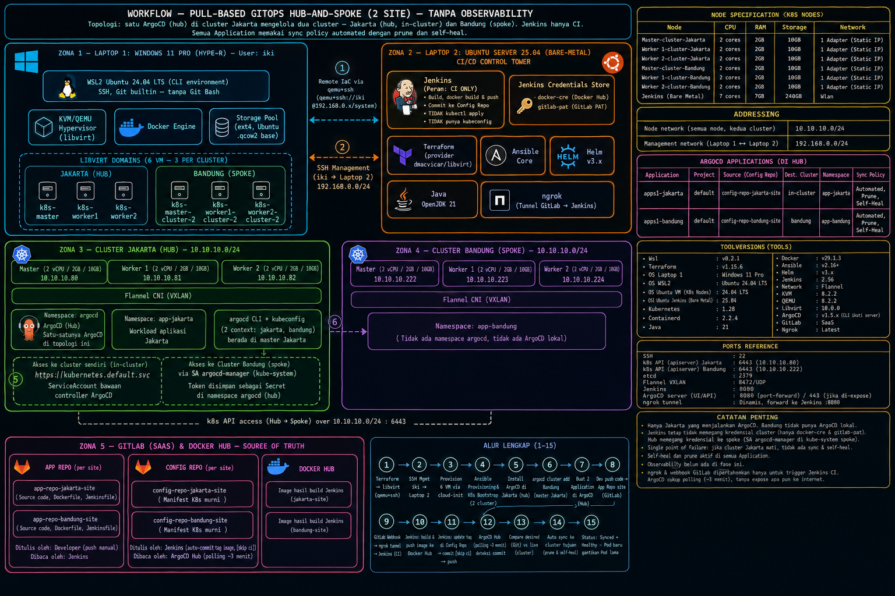

### Overview

Kali ini saya akan membuat sebuah case page dimana saya akan mengotak otak sebuah infrastructure yang sudah saya buat sebelumnya,nah kali ini saya 
akan mengotak atik infra dari pull based yang sudah saya buat dan sedikit mengubahnya,jika di projek utama infra pull based semua cluster memiliki 
satu argocd bisa di sebut bahwa infra itu stand alone argocd nah tapi untuk yang kali ini hanya akan ada satu argocd di dua cluster dan infra ini
disebut dengan hub and spoke infrastructure,dan untuk hub akan di cluster jakarta dan untuk spokenya akan di cluster bandung,oke tidak usah berlama-
lama langsung saja masuk ke pembahasannya

| Node        | CPU     | RAM  | Storage | Network                                             |
|-------------|---------|------|---------|---------------------------------------------------- |
| **Master-cluster-Jakarta**  | 2 cores | 2GB  | 10GB    | 1 Adapters   ( Static Ip )          |
| **Worker 1-cluster-Jakarta**| 2 cores | 2GB  | 10GB    | 1 Adapters   ( Static Ip )          |
| **Worker 2-cluster-Jakarta**| 2 cores | 2GB  | 10GB    | 1 Adapters   ( Static Ip )          |
| **Master-cluster-Bandung**  | 2 cores | 2GB  | 10GB    | 1 Adapters   ( Static Ip )          |
| **Worker 1-cluster-Bandung**| 2 cores | 2GB  | 10GB    | 1 Adapters   ( Static Ip )          |
| **Worker 2-Cluster-Bandung**| 2 cores | 2GB  | 10GB    | 1 Adapters   ( Static Ip )          |
| **Jenkins**                 | 7 cores | 7GB  | 240GB   |                Wlan                 |

### Structure Folder

Untuk structure folder akan terdiri dari dua folder yang pertama untuk terraform 

```
terraform-setup/
├── .terraform/
├── compute.tf
├── main.tf
├── prep-vm.tf
├── prep-2.tf
├── compute-cluster-2.tf
```

dan yang kedua yaitu ansible

```
k8s/
├── ansible.cfg
├── inventory
├── playbook-allow-port.yaml
├── playbook-ip.yaml
├── playbook-join.yaml
├── playbook-kubernetes.yaml
├── playbook-pkg.yaml
├── playbook-swap.yaml
├── playbook-config.yaml
├── argocd.yaml
```

### Reasoning
Kenapa saya memutuskan untuk membuat hub and spoke infra?? karena saya melihat bahwa infra stand alone itu tidak tersentralisasi atau terpusat 
pada satu cluster dan kurangnya aspek keamanan atau security aspect,dan juga gampang untuk di scale up jika saja ada cluster baru 

### prerequisites 
Oke sebelum masuk ke setup saya harapkan anda semua membaca ini,semua kondisi harus memenuhi 
- **CLUSTER**  : 2 (Jakarta & Bandung)
- **NODE**     : 6 (Untuk masing-masing cluster 3 node)
- **K8S**      : Terinstall di semua cluster
- **LAPTOP 2** : Laptop 2 wajib terinstall Jenkins (jenkins bertugas sebagai ci tools) dan Terraform
- **NETWORK**  : Laptop 1 bisa reach ke laptop 2 begitupun sebaliknya
- **WSL**      : Di wsl sudah terinstall KVM/QEMU
- **ARGOCD**   : Di cluster jakart yang akan menjadi hub wajib ada argocd

untuk step lebih rincinya lagi ada disini baca sampai installasi k8s selesai!! [link](https://rizkiyusupk.github.io/devops/kubernetes/linux/server/iac/infrastructure/kvm/),
lalu untuk melihat setup argocd bisa baca di [sini](https://rizkiyusupk.github.io/devops/clouds/linux/server/iac/infrastructure/pull-based1/),baca sampai selesai karena
dasar dari infrastrcuture hub and spoke,

### Setup 

Oke untuk langkah pertama cek apakah masih ada application di dalam argocd  di cluster bandung,jika ada hapus terlebih dahulu,lalu untuk langkah selanjutnya bisa di pilih 
apakah mau di uninstall atau tidak untuk argocd cluster bandung,meskipun argocd cluster bandung masih ada dan tidak di hapus tidak apa apa tidak berpengaruh,karena
application yang ada di dashboard ui argocd bandung sudah di hapus,jadinya hanya akan ada satu argocd yang akan mengarah ke app config bandung yang di projek infra awal
sebelumnya di buat,oke jadi yang harus di pastikan di tahap ini adalah tidak ada application di dashboard argocd bandung,oke jika sudah masuk ketahap selanjutnya yaitu
merging kubeconfig files,yaitu agar si cluster jakarta punya 2 context dalam satu cluster,pertama tama buat tunnling dari argocd server ke dalam localhost gunakan command

```
kubectl port-forward svc/argocd-server open-port:80 --address=0.0.0.0 -n argocd &
|
kubectl port-forward svc/argocd-server 8888:80 --address=0.0.0.0 -n argocd &
```

selanjutnya saya ingin menjelaskan terlebih dahulu apa itu context dalam k8s,jadi agar kamu bisa mengoperasikan kubernetes lewat cli kamu perlu yang namanya kubectl,nah 
kubectl atau kubecontrol ini lah yang dipakai oleh kamu nantinya kubectl bicara lewat kubeconfig yang sudah tersimpan di 

```
~/.kube/config
```

nah kubconfig itu tersimpan disana di dalam kubeconfig itu salahs atunya ialah context biasanya seperti ini

```
contexts:
- context:
    cluster: kubernetes
    user: kubernetes-admin
  name: kubernetes-admin@kubernetes
current-context: kubernetes-admin@kubernetes
kind: Config
preferences: {}
users:
- name: kubernetes-admin
  user:
```

nah kurang lebih isinya context seperti diatas ada cluster,user,nama dari context kubernetes,lalu ada current context sama dengan nama context,lalu yang terakhir ada nama 
untuk user atau client yang biasanya nanti di ujung kubconfig ada certnya sendiri,nah perlu dicatat bahwa ketika akan merging dengan kubeconfig lainnya yaitu perlu 
ganti nama dan sesesuaikan dengan nama cluster,oke masuk ke step kembali cat kubeconfig cluster bandung lalu copy isinya jika sudah masuk ke terminal di cluster jakarta,
lalu buat copy kubeconfig cluster jakarta

```
cp .kube/config .kube/config.bak-jakarta
```

oke jika sudah buat file untuk kubeconfig dari cluster bandung

```
vim .kube/config-bandung
```

lalu paste semua isi dari copy kubeconfig bandung,jika sudah edit bagian context tadi 

```
contexts:
- context:
    cluster: kubernetes <- ganti
    user: kubernetes-admin <- ganti
  name: kubernetes-admin@kubernetes <- ganti
current-context: kubernetes-admin@kubernetes <- ganti
kind: Config
preferences: {}
users:
- name: kubernetes-admin <- ganti
  user:
```

tujuan dari mengganti ini supaya tidak terjadi tabrakan dengan cluster jakarta dan kubernetes tidak kebingungan dengan dua context yang sama,lalu jika sudah masuk ke tahap
merging selanjutnya yaitu tahap flatten,tahap dimana kubeconfig bandung akan di ratakan lalu di satukan dengan kubeconfig

```
KUBECONFIG=$HOME/.kube/config:$HOME/.kube/config-bandung kubectl config view --flatten > /tmp/merged
mv /tmp/merged ~/.kube/config && chmod 600 ~/.kube/config
```

oke jika sudah sekarang cek untuk isi dari file config di cluster jakarta 
sharusnya ada dua context,jika sudah ada dua context selanjutnya login session agar nanitnya argocd bisa tau bahwa ada cluster lain yang ingin bergabung dengan nah masih
ingat tadi sudah melakukan kubectl port forward fungsi dari port forward itu ialah untuk login session ini agar argocd bisa menambahkan kubeconfig cluster bandung ke 
cluster jakarta

```
aargocd login localhost:localport --username admin --password default-password --insecure
```

untuk cara mendapatkan default passowrd nya tinggal run command ini saya ingat kan lagi 

```
kubectl -n argocd get secret argocd-initial-admin-secret -o jsonpath="{.data.password}" | base64 -d; echo
```

nah untuk default password sudah di bicarakan sebelumnya ,lalu untuk localport itu adalah port dimana
kubectl port forward tadi di buka contohnya akan menjadi seperti ini

```
argocd login localhost:8888 --username admin --password contohpassword --insecure
```

oke jika sudah login gunakan command tinggal add deh gunakan command

```
argocd cluster add name of your context --name name
```

ganti jadi nama context mu lalu nama buat context mu itu jika sudah tunggu hingga prosesnya selesai,jika sudah selesai sekarang cek dengan menggunakan command

```
argocd cluster list
```

maka seharusnya akan ada dua cluster yang muncul 

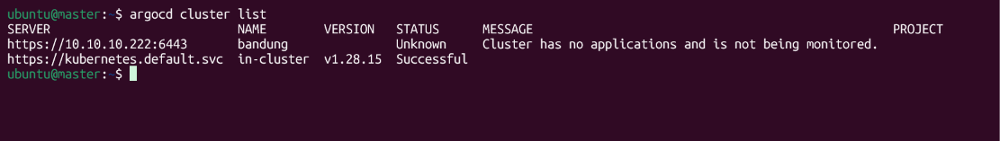

oke selamat sudah berhasil menggabungkan cluster bandung ke cluster jakarta jadinya jakarta sebagai hub dan bandung sebagi spokee,test apakah benar-benar ada di dashboard
argocd,masuk ke argocd lalu klik create application setelah itu scroll ke bawah sampai ke bagian destination

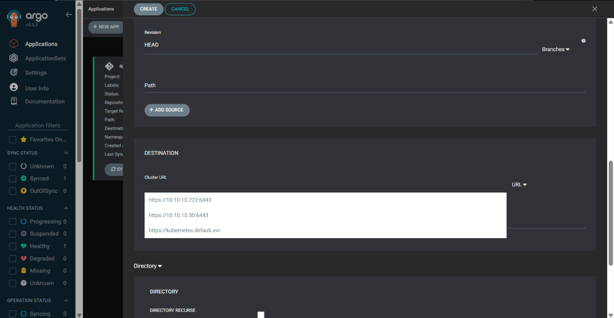

klik bagian kosong di bar destination akan ada section yang muncul dan menampilkan cluster apa saja yang ada jika tahap tadi benar maka seharusnya akan muncul ip dari 
cluster badung seperti diatas lalu coba ganti ke name dari url seharusny akan menjadi seperti ini

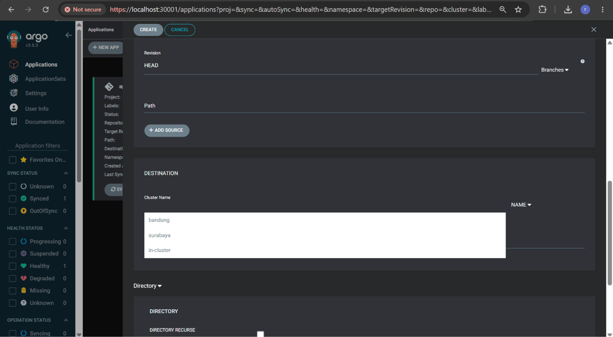

**NOTE ABAIKAN CLUSTER SURABAYA!!KARENA SUDAH DI HAPUS DARI DESAIN INFRASTRUCTURE DENGAN ALASAN WSL TIDAK SANGGUP MENAMPUNG BANYAK CPU THREADS!!!**
nah untuk bagian name ini sebenarnya sama saja cuman bedanya context yang diambil itu adalah name dari cluster yang tertulis di config yang ini loh

```
argocd cluster add name of your context --name name <--- tuh berdasarkan name ini
```

jadi bisa di sesuaikan dengan nama yang di inputkan cancel pembuatan application,oke karena sudah melakukan penggabungan config dari kedua cluster masuk ke tahapan 
selanjutnya yaitu pembuatan projects nah kenapa sih project itu penting?? itu karena project yang membuat sebuah deployment tetap terdeploy di mana seharusnya jadinya
misalkan project apps-bandung tidak akan terdeploy ke cluster jakarta karena menggunakan project app-bandung ,oke masuk langsung ke pembuatannya pergi ke settings di 
bagian kiri 

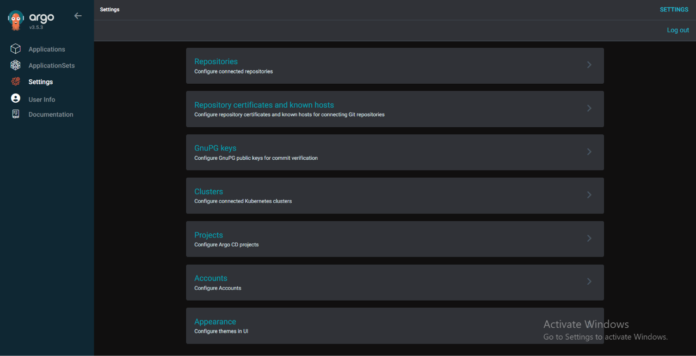

masuk ke section project lalu akan di bawa ke menu seperti ini 

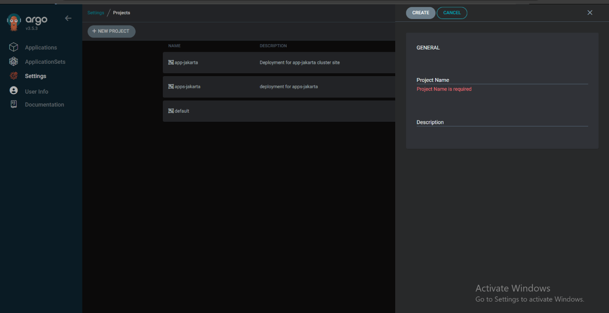

lalu buat sebuah project dengan nama bebas sesuai dengan cluster nah bisa diisi juga untuk deskripsinya

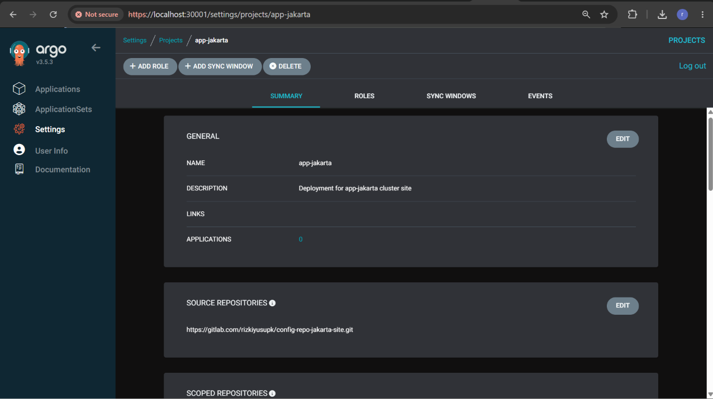

lalu setelah itu masuk ke informasi general bisa di biarkan default saja karena tidak akan terlalu berpengengaruh,lalu masuk ke section selanjutnya yaitu bagian
source untuk repo,nah pada bagian ini diisi dengan config repo ya sesuai dengan namanya source repo berarti sumber repo yang akan di ambil,oke masuk ke section selanjutnya

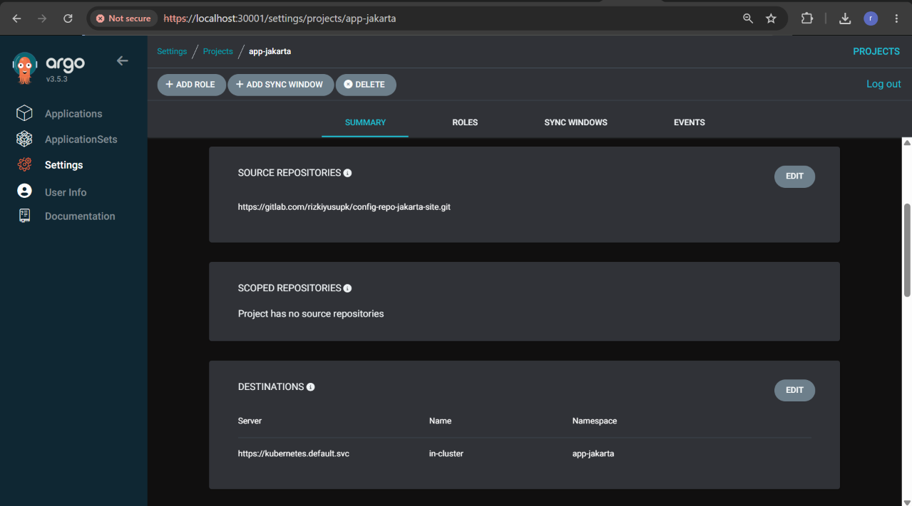

untuk section ini berisi destinations isinya tidak lain dari server lalu nama server dan namespace dimana projek akan terdeploy,masuk ke section selanjutnya

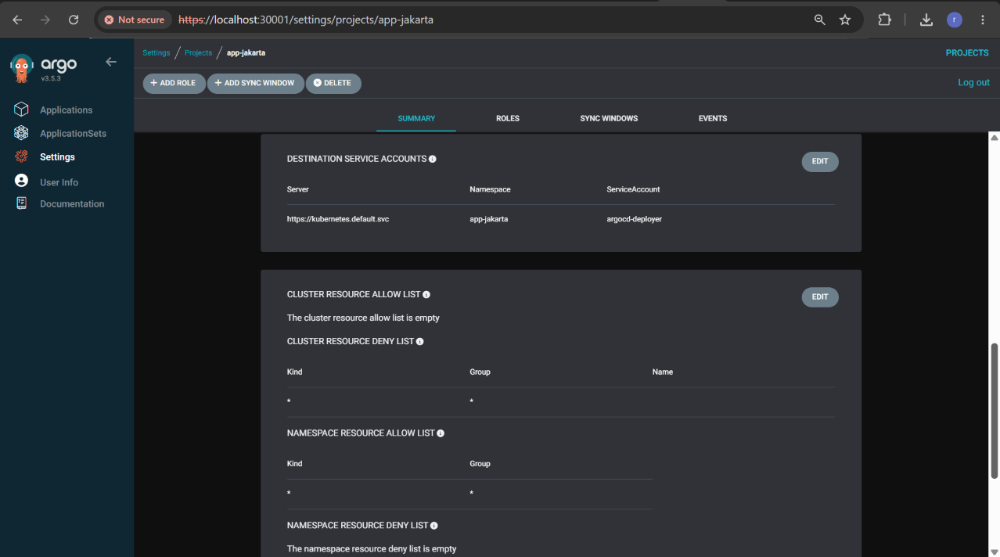

nah pada foto di bagian pertama itu destinations service account dan isinya service account,namespace dan cluster mana service account itu berada dan nantinya
argocd akan bertindak deploy manifest dengan bertindak sebagai service account tersebut,oke masuk ke bagian
selanjutnya yang cukup menarik,di bagian ini terdapat semacam rules atau permission yang akan di berikan ke deployment yang menggunakan projects ini,masuk ke bagian
pertama dari permission atau rules ini saya isi untuk  cluster resource deny list saya isi semua atau "*" kenapa? karena projects kan mengisolasi agar deployment tetap
berada di tempatnya dan service account diarahkan ke projects lalu bagian mana yang isolasi jika saja service account di projects bisa akses ke cluster resource,**NOTE!!! 
SECARA TEORI INI AKAN BERJALAN DAN TIDAK AKAN ADA ERROR SYNC KARENA KONDISI DISINI HANYA TEST HOMELAB JADI ARGOCD TIDAK MEMBUAT SEBUAH RESOURCE DARI MANIFEST,TEST HANYA
BERUPA DEPLOYMENT DAN SERVICE!!!!**,lalu jika sudah tinggal save semua config tadi lalu masuk ke dahboard utama dari argocd dan buat sebuah application untuk testing

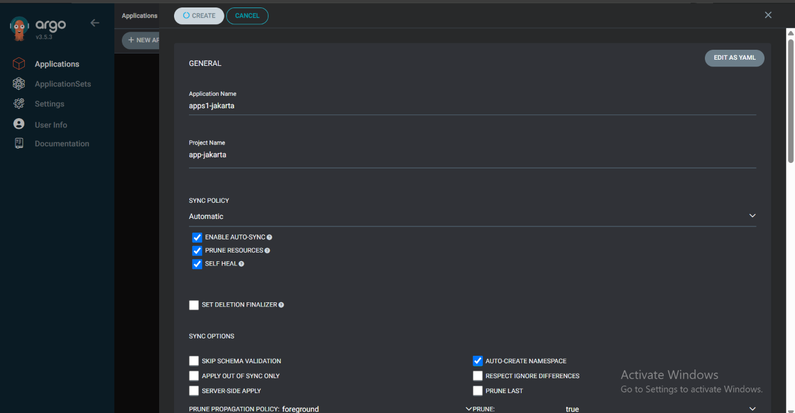

jangan lupa isi kotak kotak prune dan self heal karena ini salah satu bagian penting dari projek,lalu

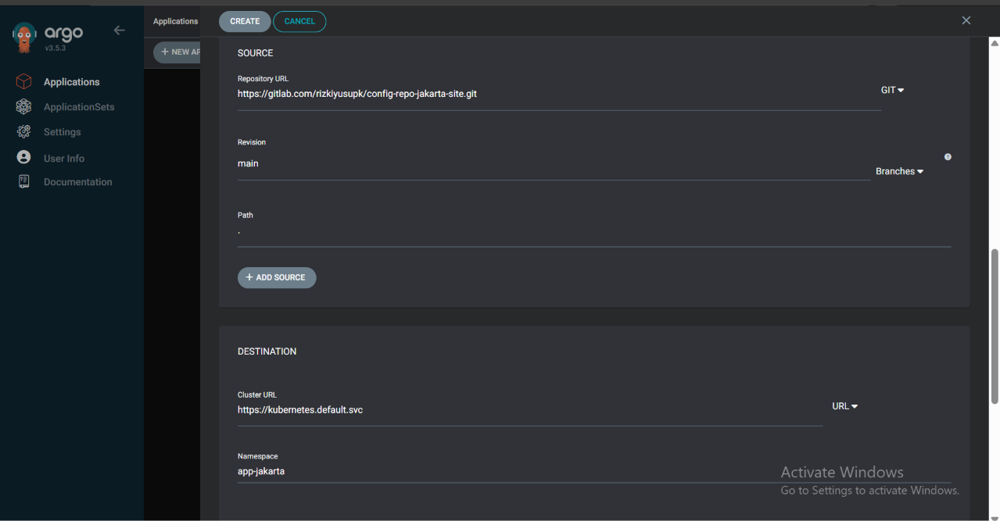

oke jika sudah tinggal klik create lalu akan ada application di dashboard

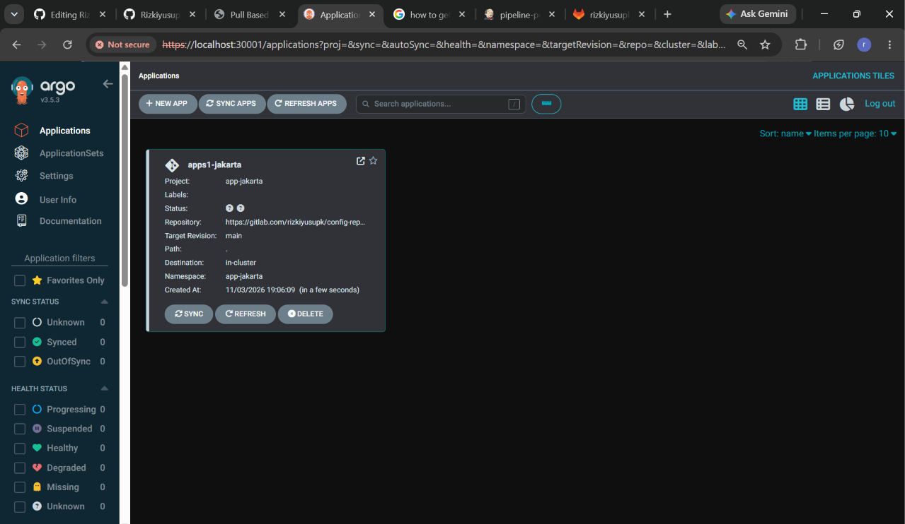

dan seharusnya sudah ada application seperti diatas itu tandanya application berhasil di buat dan configurasi untuk project berhasil application tadi bisa dihapus atau 
dipakai lagi **NOTE!!JIKA BERHASIL MAKA ULANGI LAGI UNTUK SITE BANDUNG,GANTI URL CONFIG REPO JAKARTA MENJADI URL CONFIG REPO BANDUNG SISANYA SAMA SAJA** 

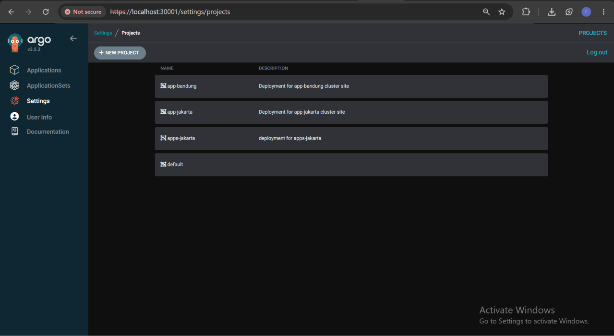

seharusnya ada dua project untuk dua cluster,lalu masuk ke bagian testing untuk membuat pipeline,pembuatan strcuture folder repo untuk deployment 2 cluster,dan resource material untuk deploymentitu 100% sama dengan dasar infra projek ini yaitu pull based tahap 1 bisa baca  sampai selesai [disini](https://rizkiyusupk.github.io/devops/clouds/linux/server/iac/infrastructure/pull-based1/),nah yang menjadi pembeda itu di hub and spoke semua
dilakukan disatu argocd,jadi yang harus dipastikan disini adalah harus ada 4 repo di gitlab/github

```
jakarta-site/
├── app-repo-jakarta-site
├── config-repo-jakarta-site
```

lalu

```
bandung-site/
├── app-repo-bandung-site
├── config-repo-bandung-site
```

oke structure repo sudah lanjut ke pipeline 100% masih menggunakan pipeline yang sama yang digunakan di projek dasarnya yaotu pull based tahap 1,jadinya sama seperti diprojek pull based tahap 1 harus ada dua pipeline ya karena memang masih menggunakan pipeline yang sama dan terhubung ke repo git yang sama juga hehe

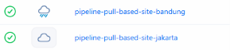

100% menggunaakn material yang sama tidak ganti sama sekali,makanya harus baca pulll based tahap 1 duulu karena memang dasar infrastructure dan materialnya dari sana semua,
oke jadi dipastikan bahwa ada 2 pipeline yang terhubung dengan dua app repo jadi masing masing cluster 1 pipeline dan sudah terhubung ke webhooks app repo masing masing,
oke jika dipastikan sudah ada resourcenya masuk ke tahap testing infra sekarang karena context bandung sudah ada di cluster jakart maka semua deployment akan dilakukan di 
argocd cluster jakarta,untuk application tadi bisa di hapus atau bisa di biarkan saja,tapi saya disini akan buat baru dua duanya dan menghapus manifest yang ada di repo 
config dari kedua cluster agar application baru tidak langsung sync dan pull manifest yang memang sudah ada di repo,

!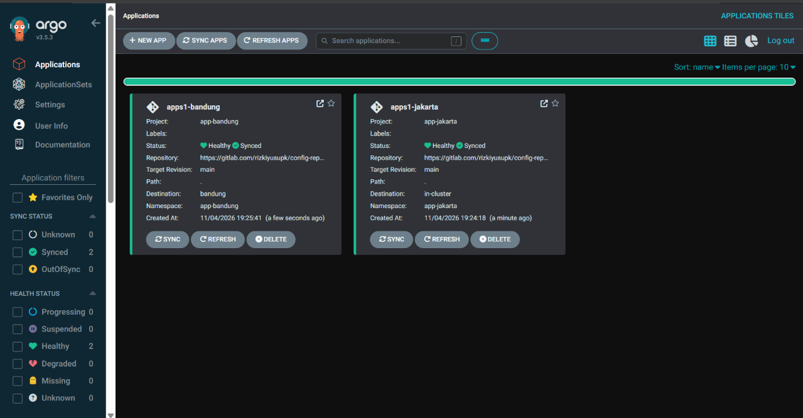

oke kurang lebih ada dua application itu menandakan bahwa kedua project berhasil di buat dan konfigurasi berjalan,oke jika sudah masuk selanjutnya persiapkan resource yang sama dengan yang ada di projek pull based tahap 1,isinya kurang lebih seperti ini 

```
app-repo-jakarta-site/
├── Dockerfile.jakarta
├── Jenkinsfile
├── site-jakarta.html
```

lalu sama seperti dijakarta isi dari app repo bandung akan sama seperti ini

```
app-repo-bandung-site/
├── Dockerfile.bandung
├── Jenkinsfile
├── site-bandung.html
```

jika sudah tau isi dari structure app repo untuk masing masing cluster langsung saja masuk ke bagian selanjutnya yaitu 
persiapan push ke repo,pertama-tama aktifkan ngrok

```
ngrok http jenkins-port
|
ngtok http 9091
```

lalu karena pipline menggunakan pipeline yang sudah dibuat sebelumnya maka tidak perlu melakukan konfigurasi lagi,ok karena
tadi sudah menghapus file manifest yang ada di config repo maka saya akan memasukan manifest yang benar benar sama kembali lagi ke config repo

```
vim kube-site-nama-cluster.yaml
|
vim kube-site-jakarta.yaml
|
apiVersion: apps/v1
kind: Deployment
metadata:
  name: apps1
  labels:
    apps1: test
  namespace: app-$site
spec:
  replicas: 1
  selector:
    matchLabels:
      apps1: test
  template:
    metadata:
      labels:
        apps1: test
    spec:
      containers:
        - name: nginx
          image: rizki736/site-$site-image:
          ports:
            - containerPort: 80


---
apiVersion: v1
kind: Service
metadata:
  name: apps1-service
  namespace: app-$site
spec:
  selector:
    apps1: test
  ports:
    - port: 80
      targetPort: 80
      nodePort: 30000
      protocol: TCP
  type: NodePort
```

nah tinggal ganti nantinya dengan cluster masing masing,bisa manual commit lewat web gitlab/github,disini saya menggunakan gitlab atau bisa pula dengan clone repo lalu push
lewat cli manual,oke dengan ini sudah ada satu file di config repo dan dianggap sudah melakukan manual push lalu untuk Jenkinsfile dan resource di app repo sama jadi saya 
tidak ganti apapun bisa langsung melakukan test push sekarang,

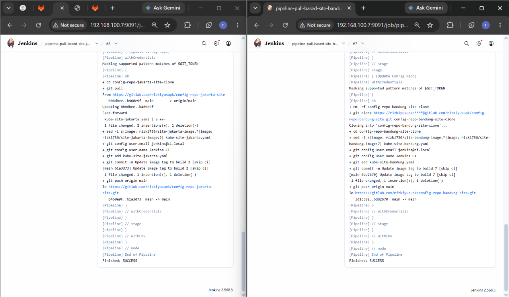

oke sudah berhasil dua pipeline sudah sukses,lalu cek ke bagian dashboard argocd

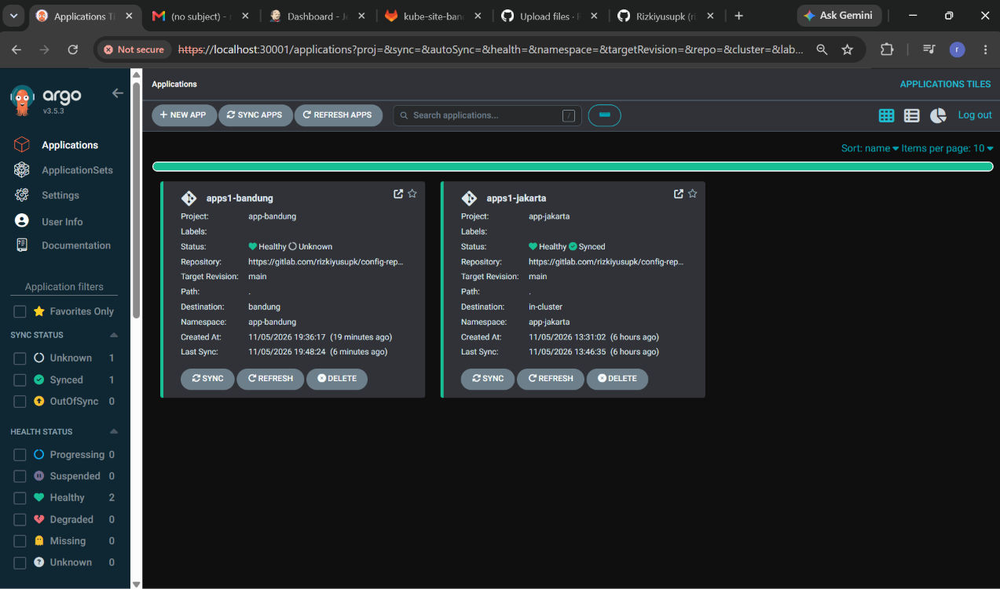

oke ternyata sudah ada dan berjalan tidak ada error dan sync berhasil,bisa dilihat bahwa kedua applicatiion hijau,lanjutt masuk ke tahap testing apakah deployment dari 
masing-masing cluster terdeploy dengan benar,masuk ke cli dari control node cluster jakarta lalu run command ini

```
kubectl config use-context $site-context
|
kubectl config use-context jakarta
```

command diatas akan berpindah ke context cluster yang diinginkan seperti diatas contohnya saya ingin menggunakan context jakarta lalu 

```
kubectl  get pods -n app-jakarta
```

untuk cek apakah ada pods yang berjalan

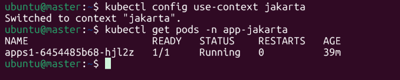

oke pods sudah berjalan dan deployment sudah berhasil dilakukan sekarang cek untuk cluster bandung sama seperti dijakarta gunakan use-context untk berpindah ke context 
bandung

```
kubectl config use-context $site-context
|
kubectl config use-context bandung
```

lalu gunakana perintaha yang sama untuk cek apakah ada pods yang berjalan

```
kubectl get pods -n app-bandung
```

seharusnya sama seperti jakarta

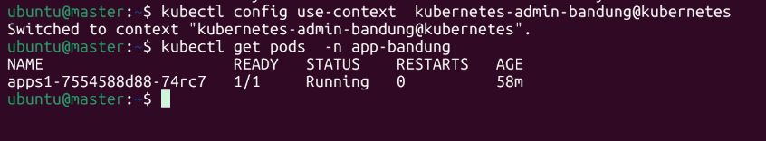

