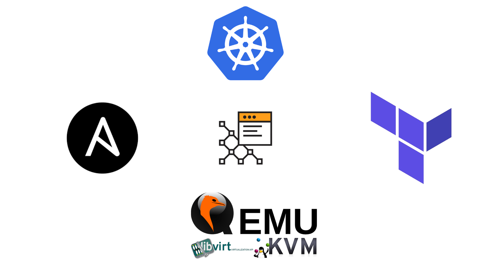

### Overview

Topik berikutnya benar-benar menguras tenaga dan pikiran saya,sebelumnya saya sudah pernah mengatakan jika saya ingin sekali menggunakan terraform namun saya tidak punya uang untuk sewa cloud
ataupun menggunakan proxmox karena laptop 2 saya itu tidak mumpuni secara spesifikasi,makanya saya dengan tekad dan semangat saya yang membara mencara cara agar saya bisa belajar terraform,
akhirnya setelah beberapa hari kebingungan harus bagaimana saya menemunkan video lama dari adinusa di youtube membahas tentang Terraform dan QEMU/KVM,saya tonton videonya dan saya menemukan
resource akun github dan docs di terraform blogspot,topik kali ini menggabungkan beberapa tools seperti kubernetes,ansible,terraform,jenkins,QEMU/KVM,libvirt sebagai api,dll. Tidak usah 
berlama-lama lagi langsung gaskannnn


| Node        | CPU     | RAM  | Storage | Network                             |
|-------------|---------|------|---------|------------------------------------ |
| **Master**  | 2 cores | 2GB  | 10GB    | 1 Adapters   ( Static Ip )          |
| **Worker 1**| 2 cores | 2GB  | 10GB    | 1 Adapters   ( Static Ip )          |
| **Worker 2**| 2 cores | 2GB  | 10GB    | 1 Adapters   ( Static Ip )          |
| **Jenkins** | 7 cores | 7GB  | 240GB   |                Wlan                 |


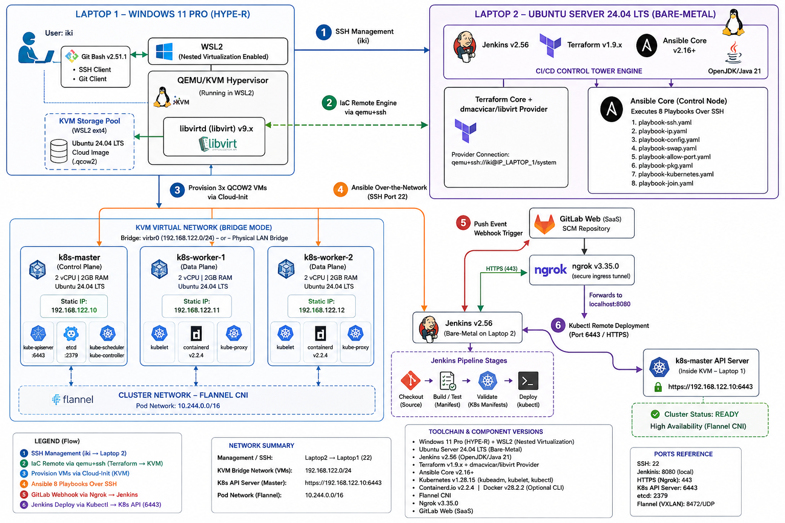


### Reasoning
Kenapa saya memilih menggunakan KVM/QEMU karena saya ingin sekali belajar terraform dan ada beberapa opsi seperti menggunakan cloud provider ataupun menggunakan proxmox,jika saya 
menggunakancloud provider sperti aws,azure,gcp saya harus memmiliki banyak uang terlebih dahulu dan saya tidak punya banyak uang untuk sewa cloud , dan jika saya memilih opsi menggunakan 
proxmox laptop 2 saya harus mempunya spesifikasi yang memumpuni sedangkan laptop 2 saya tidak memiliki spesifikasi yang mumpuni,dan jika saya menggunakan vmware biasa atau virtualbox 
tidak ada docs yang kredibel ataupun developer yang proper mendokumentasikannya,jadinya saya menggunakan KVM/QEMU dan libvirt sebagai api.Libvirt memiliki Terraform provider aktif 
(dmacvicar/libvirt), dan libvirt menyediakan API yang stabil untuk manajemen VM secara programatik. Ini juga teknologi yang sama digunakan di production environment OpenStack dan banyak 
private cloud.

### Structure Folder 

Untuk structure folder yang digunakan dalam projek ini ada dua yang pertama itu untuk terraform dan yang kedua itu ansible

```
terraform-setup/
├── compute.tf
├── main.tf
├── prep-vm.tf
```

dan yang kedua yaitu ansible

```
k8s/
├── ansible.cfg
├── inventory
├── playbook-allow-port.yaml
├── playbook-ip.yaml
├── playbook-install-java-baremetal.yaml
├── playbook-install-jenkins-baremetal.yaml
├── playbook-install-kubectl-baremetal.yaml
├── playbook-install-terraform-bare-metal.yaml
├── playbook-join.yaml
├── playbook-kubernetes.yaml
├── playbook-pkg.yaml
├── playbook-swap.yaml
├── playbook-config.yaml
```


### Tools
- **OS Laptop 1: Windows 11**
- **OS Ubuntu  Vm** : 24.04 LTS 
- **OS Ubuntu Jenkins Node (Bare Metal)** : 25.04
- **VirtualBox** : 7.0.10
- **Kubernetes** : 1.28
- **Containerd** : 2.2.4
- **Java** : 21
- **Jenkins** : 2.56
- **Network** : Flannel
- **Ngrok** : 3.35.0
- **Giy Bash** : 2.51.1
- **Gitlab** : Web
- **Vscode**
- **Terraform** :  v1.15.6
- **Ansible** : v2.18.1
- **KVM** :  v 8.2.2
- **QEMU** :  v 8.2.2
- **LIBVIRT** : 10.0.0

### Catatan Kompatibilitas
Dites pada: VM Ubuntu 22.04 (jammy, dari image cloud) dan node Jenkins Ubuntu 25.04.
Kalau memakai rilis Ubuntu lain, alur playbook dan module-nya sama. Yang perlu
disesuaikan hanya yang bergantung pada codename rilis:
- HashiCorp: ubah `hashicorp_suite` bila suite rilis belum ada di repo mereka.
- Docker: pastikan `download.docker.com` sudah punya suite untuk rilis tersebut.
- Terraform: ganti URL image di `prep-vm.tf`.
 
### Setup Bare Metal

**NOTE!!!!! DIKARENAKAN PROJEK INI IALAH PENGGABUNGAN PHASE 1 AWS DAN PHASE 2 KVM/QEMU JADINYA UNTUK SETUP AWAL TIDAK ADA YANG BERUBAH HANYA MENSETUP KVM/QEMU+ PBSERV DAN AWS 
PHASE 1,JADINYA BISA DI SKIP KE BAGIAN BAWAH TEPATNYA DI AWS PHASE 1!!**
Dikarenakan ini menggunakan bare metal dan bukan vm disini tidak ada setup vm seperti biasanya,jadi saya menggunakan laptop lama saya yang 
sudah jarang di gunakan sebagai single node dan kebetulan os dari laptop lama saya itu ubuntu jadinya saya bisa memanfaatkan laptop usang saya 
sebagai bahan belajar
Pertama-tama karena laptop lama saya itu os ubuntu tapi GUI dan bukan CLI saya akan merubahnya terlebih dahulu 
gunakan command 

```
sudo systemctl set-default multi-user.target
sudo reboot
```

setelah itu os akan reboot dan akan masuk ke mode CLI 

dari yang tadinya GUI 

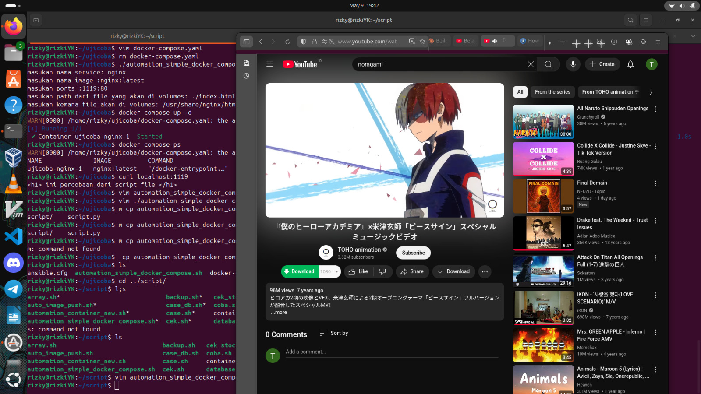

ke CLI


jika ingin kembali ke tampilan GUI dari CLI ketik command

```
sudo systemctl set-default graphical.target
sudo reboot
```

jika sudah masuk ke file konfigurasi dari ssh karena nantinya akan dibutuhkan proxy jump untuk ssh,karena infrastructure dari projek ini yang lumayan rumit jadi sulit untuk menembus
layer firewall dan security dari masing masing os jadi antara laptop 1 dan laptop 2 cuman bisa ssh satu sama lain tidak bisa laptop 2 mengkases cluster yang berada di dalam wsl
oke langsung saja

```
vim ~/.ssh/config
|
Host hype-r
    HostName ip-laptop-1
    User rizki
    IdentityFile ~/.ssh/id_rsa

Host k8s-master
    HostName ip-master
    User ubuntu
    ProxyJump hype-r

Host k8s-worker1
    HostName ip-worker1
    User ubuntu
    ProxyJump hype-r

Host k8s-worker2
    HostName ip-worker2
    User ubuntu
    ProxyJump hype-r
```

jika sudah masuk ke bagaian installasi ansible,dikarenaka ansible disini akan berperan sebagai tools iac untuk proses installasi dari terraform dan jenkins itu sendiri oke langsung saja
gunakan command

```
sudo apt-get update
sudo apt install ansible -y
```

tunggu hingga proses installasi selesai jika sudah buat sebuah folder dengan nama k8s

```
mkdir k8s
cd k8s
```

jika sudah berada di dalam folder k8s lalu buat file anisble.cfg

```
vim ansible.cfg
|
[defaults]
inventory = /home/rizky/k8s/inventory
remote_user = rizky
host_key_checking = False
become = yes
become_method = sudo
become_ask_pass = False
```

oke untuk ansible.cfg sudah dibuat tinggal buat inventorynya

```
[Jenkins]
node-Jenkins ansible_host=ip-laptop2


[all:vars]
ansible_user=rizky
ansible_ssh_private_key_file=~/.ssh/id_rsa
ansible_ssh_common_args='-o ProxyJump=rizki@192.168.100.36 -o StrictHostKeyChecking=no'

```

oke karena ansible itu terletak di bagian laptop 2 jadinya laptop 2 akan bertindak sebagai control tower yang akan menginisiasi ansible maupun terraform dan untuk ansible config kali ini
itu hanya sementara nantinya akan ada tambahan bagian untuk ansible config seperti menambahkan ip dari domain atau node di KVM/QEMU jadinya ansible ini hanya sementara,oke masuk ke tahap 
selanjutnya yaitu proses installasi dari terraform menggunakan ansible 

```
vim playbook-install-terraform-bare-metal-native.yaml
|
- name: install terraform bare metal
  hosts: Jenkins
  become: yes
  tasks:
    - name: Ensure keyrings directory exists
      ansible.builtin.file:
        path: /etc/apt/keyrings
        state: directory
        mode: "0755"
    - name: download gpg key
      ansible.builtin.get_url:
      url: https://apt.releases.hashicorp.com/gpg
      dest: /etc/apt/keyrings/hashicorp-archive-keyring.asc
      mode: "0644"
    - name: verify gpg
      ansible.builtin.shell: gpg --no-default-keyring --keyring /etc/apt/keyrings/hashicorp-archive-keyring.asc --fingerprint
      changed_when: false
    - name: Add HashiCorp apt repository
      ansible.builtin.apt_repository:
        repo: >-
          deb [arch={{ 'amd64' if ansible_architecture == 'x86_64' else 'arm64' }}
          signed-by=/etc/apt/keyrings/hashicorp-archive-keyring.asc]
          https://apt.releases.hashicorp.com {{ ansible_distribution_release }} main
        filename: hashicorp
        state: present
    - name: install terraform
      ansible.builtin.apt:
        name: terraform
        state: present
        update_cache: yes

```

playbook diatas menggunakan dua module yang pertama yaitu module shell dan yang kedua yaitu module apt untuk melakukan installasi,di dua task pertama yaitu install gpg key dan verify gpg 
key,semua sesuai dengan urutan proses installasi yang ada di docs resmi dari hashi corp dimulai dari installasi gpg key setelah proses installasi selesai lalu dilanjut dengan verify gpg 
key dan untuk task ketiga yaitu menambahkan repo resmi dari terraform,setelah itu masuk ke modul shell dimana dimodul ini proses yang penting akan dimulai seperti update package setelah
menambahkan key dan repository lalu melakukan instllasi dari terraform itu sendiri karena saya menggunakan modul resmi dari ansible untuk ubuntu yaitu apt jadinya tidak ada halangan dan 
proses berjalan lancar gunakan command

```
ansible-playbook playbook.yaml
|
ansible-playbook playbook-install-terraform-bare-metal-native.yaml
```

jika sudah masuk ke proses selanjutnya yaitu installasi dari jenkins 

```
vim playbook-install-java-baremetal-native.yaml
|
- name: install java
  hosts: Jenkins
  become: yes
  tasks:
    - name: install jdk
      ansible.builtin.apt:
        name:
          - openjdk-21-jdk
          - fontconfig
        state: present
        update_cache: yes
```

dalam playbook ini saya menggunakan java 21 karena untuk menghindari error karena perbedaan versi dengan jenkins,tidak seperti di projek-projek sebelumnya yang menggunakan java versi 17 
sekarang saya menggunakan java versi baru, dan menggunakan dua module dengan shell dan command yang saya gunaakan dalam playbook ini.Gunakan command

```
ansible-playbook playbook.yaml
|
ansible-playbook playbook-install-java-baremetal-native.yaml
```

masuk ke playbook selanjutnya

```
vim playbook-install-jenkins-baremetal-native.yaml
|
- name: install jenkins baremetal
  hosts: Jenkins
  become: yes
  tasks:
    - name: install gpg key for kubernetes
      ansible.builtin.get_url:
        url: https://pkg.jenkins.io/debian-stable/jenkins.io-2026.key
        dest: /etc/apt/keyrings/jenkins-keyring.asc
        mode: "0644"
    - name: adding file
      ansible.builtin.apt_repository:
        repo: "deb [signed-by=/etc/apt/keyrings/jenkins-keyring.asc] https://pkg.jenkins.io/debian-stable binary/"
        filename: Jenkins
        state: present
        update_cache: yes
    - name: install jenkins
      ansible.builtin.apt:
        name: jenkins
        state: present
        update_cache: yes
    - name: Enable and start Jenkins
      ansible.builtin.service:
        name: jenkins
        state: started
        enabled: true

```

saya menggunakan jenkins versi terbaru,dan ada beberapa penyesuaian dalam playbook kali ini seperti memperbaiki command yang di gunakan, jika sebelum-sebelumnya saya menambahkan
key ke **/usr/share** tetapi apt mencari key di **/etc/apt** ini menimbulkan kekeliruan dan error yang fatal,ternyata saya tidak teliti dalam membuat script jadi saya memperbaiki dari
projek **buiild hybrid Ci/Cd**, jika sudah langsung gunakan command

```
ansible-playbook playbook.yaml
|
ansible-playbook playbook-install-jenkins-baremetal-native.yaml
```

jika sudah masuk ke port

```
http://ip-node:9091
```

port default dari jenkins adalah 8080, jadi ketika proses installasi selesai jenkins akan langsung berjalan di port 8080,jika sudah maka akan ada tampilan seperti ini

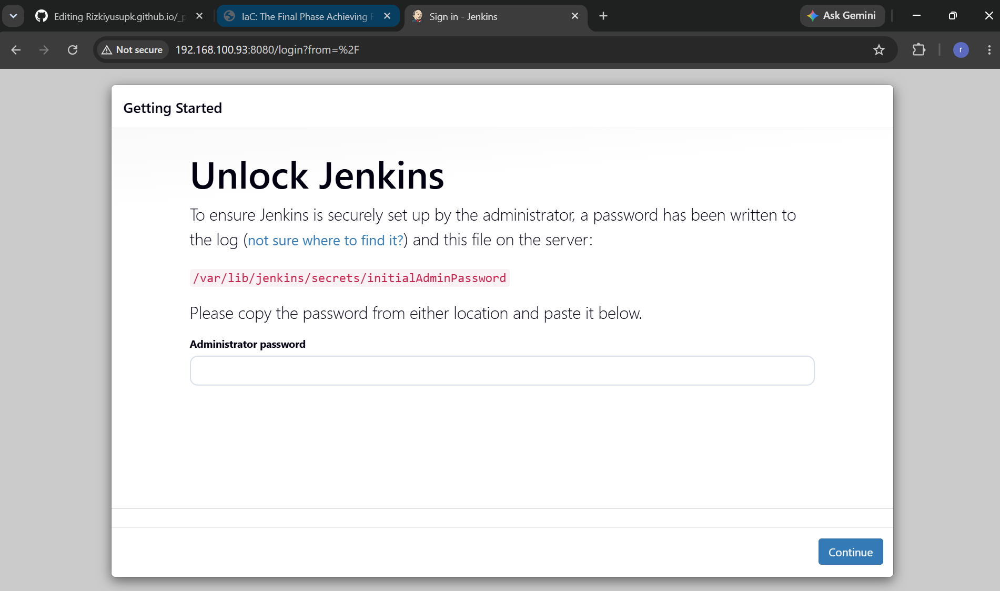

masuk ke terminal node jenkins lalu buka file yang berisi file password awal untuk admin,jika sudah copy lalu pastekan ke jenkins tadi lalu klik continue
jika sudah maka akan di bawa ke tampilah dashboard seperti ini

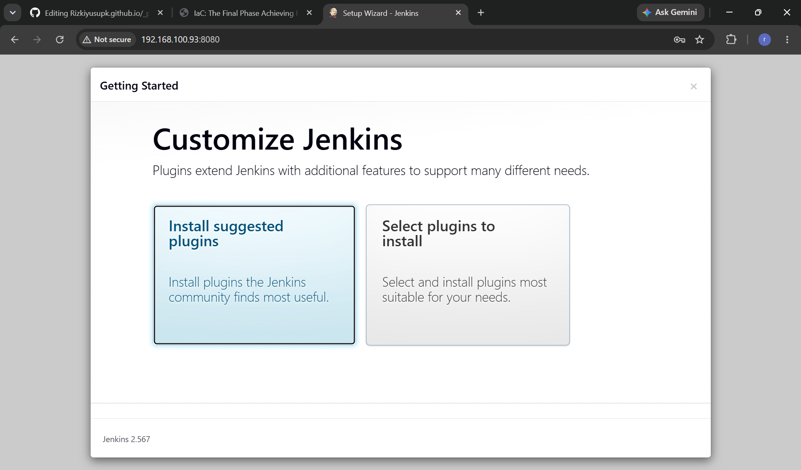

akan ada dua pilihan opsi seperti diatas pilih yang kiri atau install sugested jenkins plugins,karena ini awal jadi tidak perlu opsi sebelah kanan karena untuk sebelah kanan itu
jika perlu custom plugins untuk jenkins jadinya hanya untuk case khusus dimana pengguna harus secara spesifik memilih plugins yang akan di install,jika belum klik opsi kiri dua kali

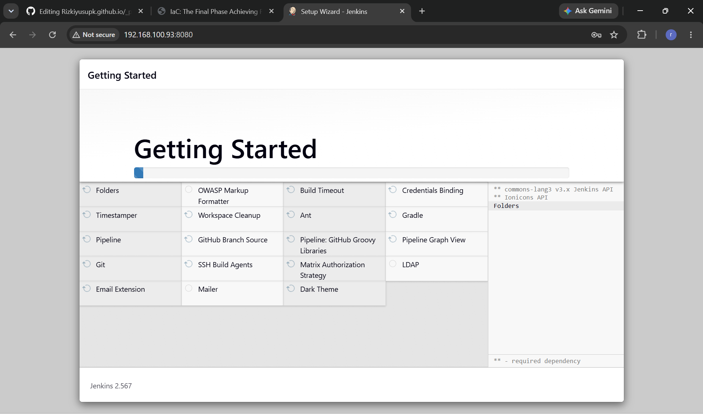

lalu kamu akan diarahkan ke menu installasi manual seperti diatas tunggu saja sampai proses installasi selesai,jika sudah 

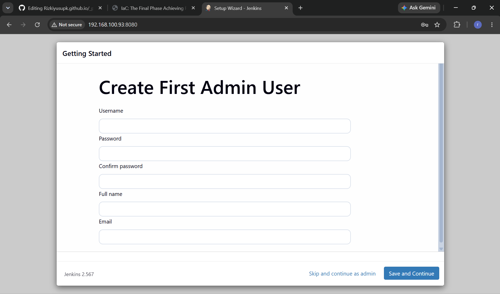

maka akan ada tampilan pembuatan akun admin, buat sebuah akun terlebih dahulu,jika proses pembuatan akun sudah selesai 

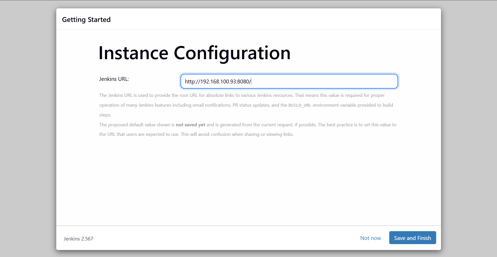

maka akan dibawa ke tampilan dashboard seperti diatas klik saja save and finish,jika sudah kamu akan di bawa ke halaman dashboard seperti ini

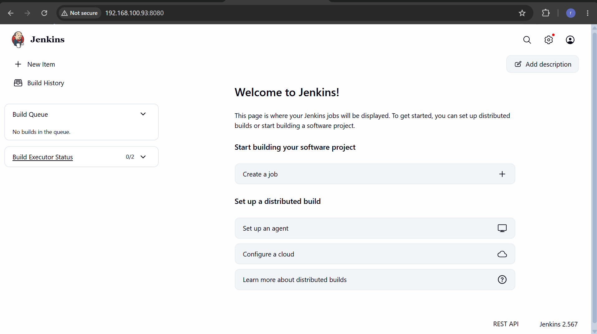


lalu proses installasi jenkins sudah selesai sekarang bagian setup plugins dan credentials,klik icon settings di pojok kanan atas

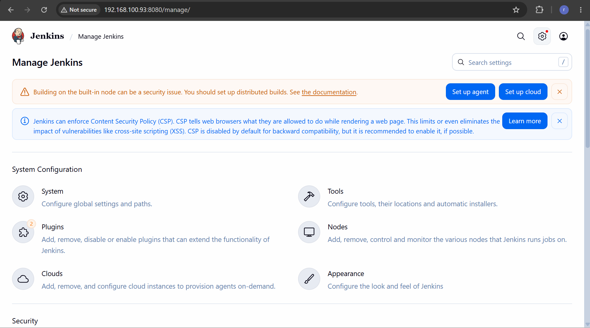

kamu akan di arahkan ke menu seperti diatas,scrool kebawah sedikit nanti akan ada menu credentials

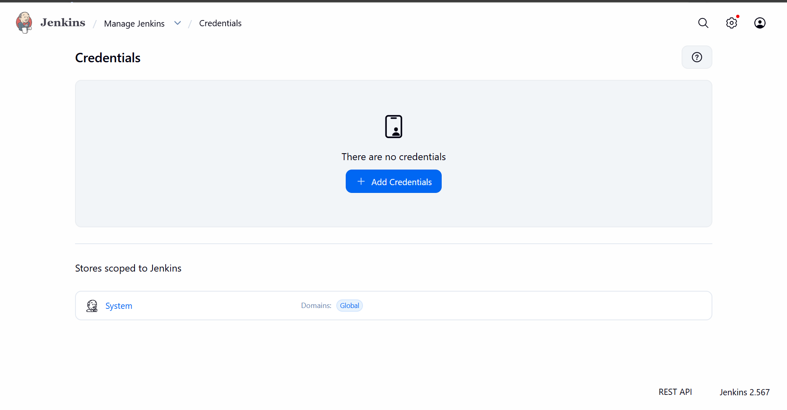

jika klik bagian credentials tadi maka akan diarahkan ke menu seperti diatas,lalu klik add credentials

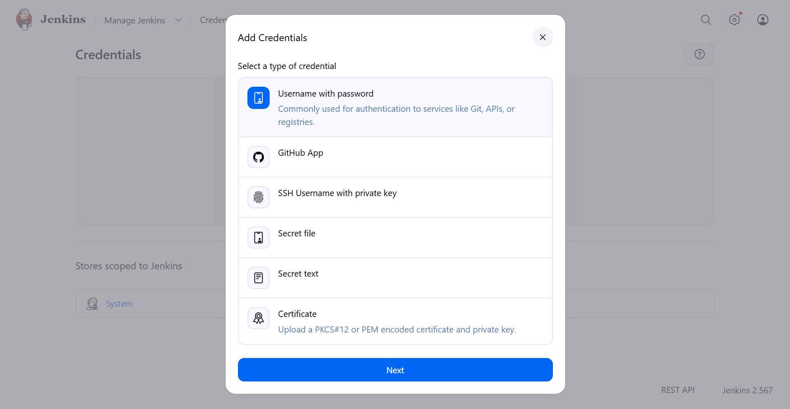

akan ada popup menu seperti diatas pilih opsi username with password karena itu akan dipakai untuk credentials nanti untuk trigger webhook di gitlab
isi semua kolom yang harus diisi

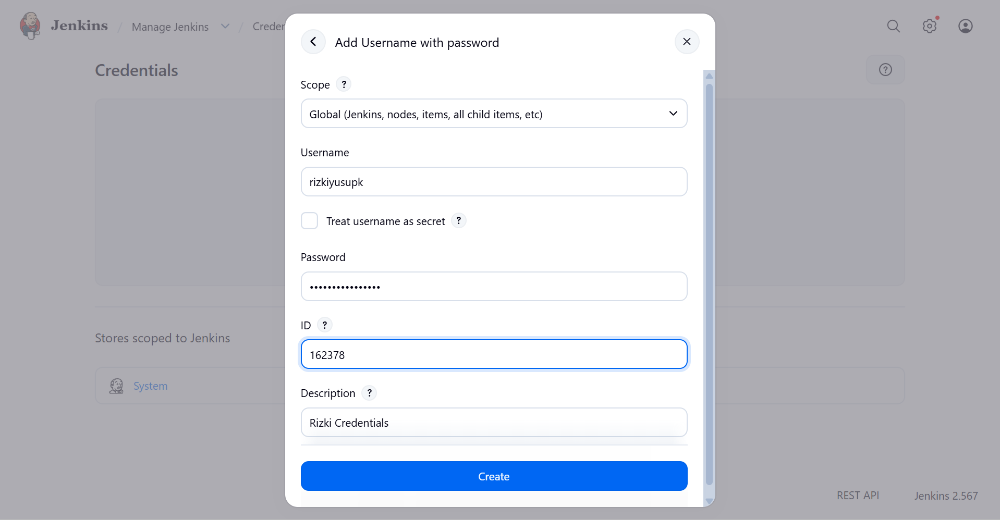

kurang lebih seperti diatas untuk kolom yang harus diisi,saya menggunakan username untuk login ke gitlab dan passwordnya, karena saya menggunakan
email biasa jadinya saya menggunakan username dan password email utama saya yang saya gunakan untuk login ke gitlab,jika sudah klik create
jika sudah kembali ke menu manage jenkins lalu cari bagian plugin atau bisa gunakan tombol search lalu ketik plugins

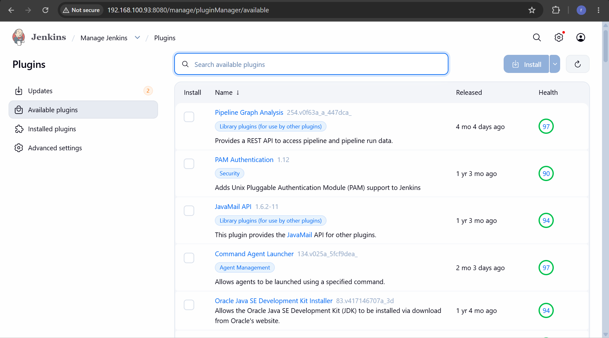

nantinya tampilanya akan seperti diatas lalu cari plugin berikut

```
Gitlab
Gitlab Authentication
Gitlab Gitlab Api
Generic Webhook Trigger
```

list sudah ada tinggal cari lalu install satu persatu

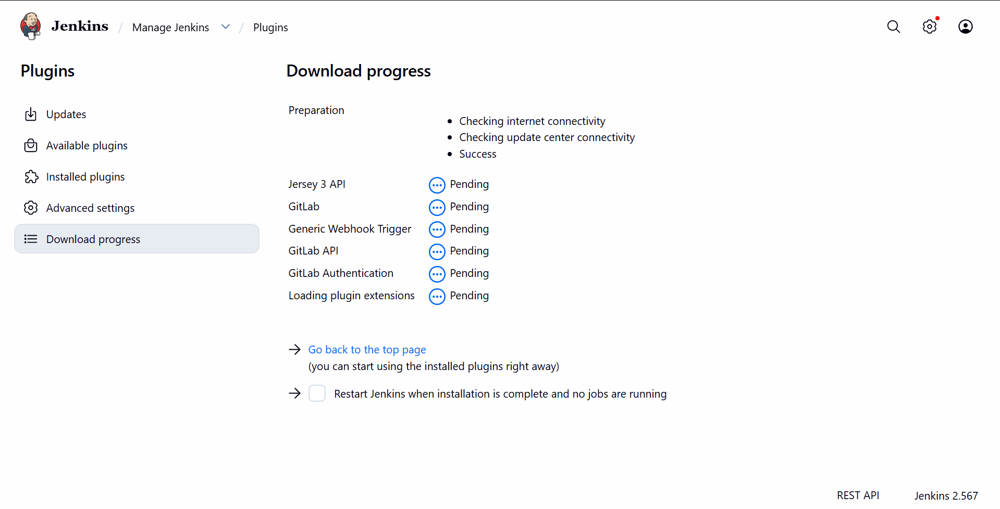

Setup Jenkins sudah selesai,jika sudah masuk ke tahap selanjutnya yaitu installasi dari kubectl,kenapa ini penting karena nantinya jenkins atau laptop 2 harus bisa mengakses cluster yang berada didalam laptop 1 oleh
karena itu laptop 2 harus diinstall kubectl agar nantinya bisa menggunakan command-command kubernetes tapi tidak perlu keseluruhan atau semua komponen dari kubernetes diinstall cukup
kubectl karena laptop 2 hanya perlu menggunakan command-comamnd kubernetes

```
vim playbook-install-kubectl-bare-metal-native.yaml
|
- name: install kubectl on baremetal
  hosts: Jenkins
  become: yes
  tasks:
    - name: install prerequisite
      ansible.builtin.apt:
        name:
          - apt-transport-https
          - ca-certificates
          - curl
        state: present

    - name: adding key
      ansible.builtin.get_url:
        url: https://pkgs.k8s.io/core:/stable:/v1.28/deb/Release.key
        dest: /etc/apt/keyrings/kubernetes-apt-keyring.asc
        mode: "0655"
    - name: signed repo
      ansible.builtin.apt_repository:
        repo: "deb [signed-by=/etc/apt/keyrings/kubernetes-apt-keyring.asc] https://pkgs.k8s.io/core:/stable:/v1.28/deb/ /"
        filename: kubectl
        state: present
        update_cache: yes
    - name: install kubectl
      ansible.builtin.apt:
        name: kubectl
        state: present
```

playbook diatas akan melakukan seluruh installasi untuk menginstall hanya jenkins saja jika ingat karena itu memang tujuan utama dari bagian in jadi jangan heran dengan playbook yang 
hanya separuh gunakan command 

```
ansible-playbook playbook.yaml
ansible-playbook playbook-install-kubectl-baremetal.yaml
```

tunggu hingga proses selesai

### Setup Cluster

Untuk  tahap selanjutnya yaitu provisioning menggunakan terraform disini saya menggunakan provider dari komunitas untuk link resourcenya ada [disini](https://github.com/dmacvicar/terraform-provider-libvirt) 
dan untuk resource dari docsnya [disini](https://registry.terraform.io/providers/dmacvicar/libvirt/latest/docs/resources/pool),jika sudah dengan referensinya langsung saja masuk ke file

```
vim main.tf
|
terraform {
  required_providers {
    libvirt = {
      source = "dmacvicar/libvirt"
    }
  }
}
provider "libvirt" {
  uri = "qemu+ssh://rizki@ip-laptop1/system"
  
}
```

disini saya menyesuaikan sesuai dengan  example yang ada di docs dan untuk uri bisa diganti dengan ip dari node masing-masing, jika sudah dengan file provider atau main.tfnya bisa masuk
ke file selanjutnya jika sudah membuat eval agar si terraform bisa membuat sebuah perubahan 

```
eval $(ssh-agent -s)
ssh-add ~/.ssh/id_rsa
```

jika sudah gunakan command

```
terraform init
```

lalu tunggu proses hingga selesai bagian lalu akan ada output seperti

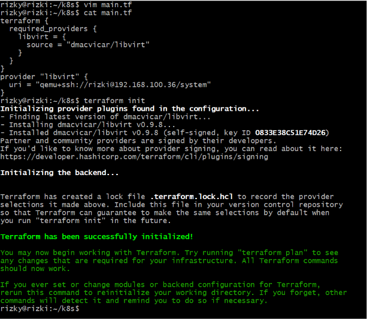

jika berhasil maka output dari terraform akan seperti gambar diatas,masuk ke file selanjutnya 

```
vim prep.tf
|
resource "libvirt_pool" "k8s_pool" {
  name = "k8s-cluster-pool"
  type = "dir"
  target = {
    path = "/var/lib/libvirt/images/k8s-cluster"
  }
}


resource "libvirt_volume" "ubuntu_base" {
  name   = "ubuntu-jammy-base.qcow2"
  pool   = libvirt_pool.k8s_pool.name
  target = {
    format = {
      type = "qcow2"
    }
  }

  create = {
    content = {
      url = "https://cloud-images.ubuntu.com/jammy/current/jammy-server-cloudimg-amd64.img"
    }
  }
}

resource "libvirt_volume" "vm-master" {
  name   = "vm-master.qcow2"
  pool   = libvirt_pool.k8s_pool.name
  target = {
    format = {
      type = "qcow2"
    }
  }

  
  capacity = 10737418240
  
  backing_store = {
    path   = libvirt_volume.ubuntu_base.path
    format = {
      type = "qcow2"
    }
  }
}

resource "libvirt_cloudinit_disk" "vm-master" {
  name = "vm-master-spec"

  user_data = <<-EOF
  #cloud-config
  users:
    - name: ubuntu
      sudo: ALL=(ALL) NOPASSWD:ALL
      lock_passwd: false
      shell: /bin/bash
  chpasswd:
    list: |
      ubuntu:$your-password
    expire: false
  ssh_pwauth: true
  packages:
    - openssh-server
  timezone: UTC
  EOF

 meta_data = <<-EOF
    instance-id: vm-master
    local-hostname: master
  EOF

  network_config = <<-EOF
    version: 2
    ethernets:
      interfaces:
        match:
          name: enp1s0
        dhcp4: true
  EOF
}

resource "libvirt_volume" "vm-master-cloudinit" {
  name = "vm-master-cloudinit.iso"
  pool = libvirt_pool.k8s_pool.name

  create = {
    content = {
      url = libvirt_cloudinit_disk.vm-master.path
    }
  }
}

resource "libvirt_volume" "vm-worker1" {
  name   = "vm-worker1.qcow2"
  pool   = libvirt_pool.k8s_pool.name
  target = {
    format = {
      type = "qcow2"
    }
  }

  
  capacity = 10737418240 

  backing_store = {
    path   = libvirt_volume.ubuntu_base.path
    format = {
      type = "qcow2"
    }
  }
}


resource "libvirt_cloudinit_disk" "vm-worker1" {
  name = "vm-worker1-spec"

  user_data = <<-EOF
  #cloud-config
  users:
    - name: ubuntu
      sudo: ALL=(ALL) NOPASSWD:ALL
      lock_passwd: false
      shell: /bin/bash
  chpasswd:
    list: |
      ubuntu:$your-password
    expire: false
  ssh_pwauth: true
  packages:
    - openssh-server
  timezone: UTC
 EOF

  meta_data = <<-EOF
    instance-id: vm-worker1
    local-hostname: worker
  EOF


  network_config = <<-EOF
    version: 2
    ethernets:
      interfaces:
        match:
          name: enp1s0
        dhcp4: true
  EOF
}

resource "libvirt_volume" "vm-worker1-cloudinit" {
  name = "vm-worker1-cloudinit.iso"
  pool = libvirt_pool.k8s_pool.name
  

  create = {
    content = {
      url = libvirt_cloudinit_disk.vm-worker1.path
    }
  }
}

resource "libvirt_volume" "vm-worker2" {
  name   = "vm-worker2.qcow2"
  pool   = libvirt_pool.k8s_pool.name
  target = {
    format = {
      type = "qcow2"
    }
  }


  capacity = 10737418240
  
  backing_store = {
    path   = libvirt_volume.ubuntu_base.path
    format = {
      type = "qcow2"
    }
  }
}

resource "libvirt_cloudinit_disk" "vm-worker2" {
  name = "vm-worker2-spec"

  user_data = <<-EOF
  #cloud-config
  users:
    - name: ubuntu
      sudo: ALL=(ALL) NOPASSWD:ALL
      lock_passwd: false
      shell: /bin/bash
  chpasswd:
    list: |
      ubuntu:$your-password
    expire: false
  ssh_pwauth: true
  packages:
    - openssh-server
  timezone: UTC
 EOF

  meta_data = <<-EOF
    instance-id: vm-worker2
    local-hostname: worker2
  EOF


  network_config = <<-EOF
    version: 2
    ethernets:
      interfaces:
        match:
          name: enp1s0
        dhcp4: true
  EOF
}

resource "libvirt_volume" "vm-worker2-cloudinit" {
  name = "vm-worker2-cloudinit.iso"
  pool = libvirt_pool.k8s_pool.name


  create = {
    content = {
      url = libvirt_cloudinit_disk.vm-worker2.path
    }
  }
}
```

nah di prep ini merupakan persiapan dari pembuatan domain atau bisa disebut sebagai vm dalam konteks KVM/QEMU ini

```
resource "libvirt_pool" "k8s_pool" {
  name = "k8s-cluster-pool"
  type = "dir"
  target = {
    path = "/var/lib/libvirt/images/k8s-cluster"
  }
}


resource "libvirt_volume" "ubuntu_base" {
  name   = "ubuntu-jammy-base.qcow2"
  pool   = libvirt_pool.k8s_pool.name
  target = {
    format = {
      type = "qcow2"
    }
  }

  create = {
    content = {
      url = "https://cloud-images.ubuntu.com/jammy/current/jammy-server-cloudimg-amd64.img"
    }
  }
}
```

di bagian pertama saya membuat sebuah pool dengan nama k8s_pool dan volume dengan nama ubuntu_base sebagai tempat penyimpanan image
menaruh tempat default bagi pool untuk berada di **/var/lib/libvirt/images/k8s-cluster/**,pool berfungsi sebagaitempat dimana nanti domain atau vm yang akan menjadi cluster itu berjalan
dan bukan hanya itu saja pool berfungsi sebagai tempat menyimpan volume dan juga volume berfungsi sebagai tempat penyimpanan dari image dan juga harddisk dimana nanti penyimpanan vm 
disimpan,dan untuk base image saya menggunakan ubuntu 22 

```
resource "libvirt_volume" "vm-master" {
  name   = "vm-master.qcow2"
  pool   = libvirt_pool.k8s_pool.name
  target = {
    format = {
      type = "qcow2"
    }
  }

  
  capacity = 10737418240
  
  backing_store = {
    path   = libvirt_volume.ubuntu_base.path
    format = {
      type = "qcow2"
    }
  }
}

resource "libvirt_cloudinit_disk" "vm-master" {
  name = "vm-master-spec"

  user_data = <<-EOF
  #cloud-config
  users:
    - name: ubuntu
      sudo: ALL=(ALL) NOPASSWD:ALL
      lock_passwd: false
      shell: /bin/bash
  chpasswd:
    list: |
      ubuntu:$your-password
    expire: false
  ssh_pwauth: true
  packages:
    - openssh-server
  timezone: UTC
  EOF

 meta_data = <<-EOF
    instance-id: vm-master
    local-hostname: master
  EOF

  network_config = <<-EOF
    version: 2
    ethernets:
      interfaces:
        match:
          name: enp1s0
        dhcp4: true
  EOF
}

resource "libvirt_volume" "vm-master-cloudinit" {
  name = "vm-master-cloudinit.iso"
  pool = libvirt_pool.k8s_pool.name

  create = {
    content = {
      url = libvirt_cloudinit_disk.vm-master.path
    }
  }
}

```

saya jelaskan untuk bagian dari prep vm-master dimulai dengan pembuatan harddisk atau bisa dibilang dengan setup ukuran dari vm atau node dari vm-master

```
resource "libvirt_volume" "vm-master" {
  name   = "vm-master.qcow2"
  pool   = libvirt_pool.k8s_pool.name
  target = {
    format = {
      type = "qcow2"
    }
  }

  
  capacity = 10737418240
  
  backing_store = {
    path   = libvirt_volume.ubuntu_base.path
    format = {
      type = "qcow2"
    }
  }
}
```

saya menamai dengan nama vm-master dan setiap node wajib beda karena nantinya bisa menghindari kemungkinan dari error atau tabrakan antara node dengan node lainnya,saya membuat ukuran dari
disk vm-master ini sebesar 10gb atau jika ingin spesifik yaitu sebesar **10737418240**,kenapa tidak langsung 10gb? karena didalam docs resminya harus di tulis dalam byte jadinya tidak bisa
langsung menulis dalam ukuran 10gb,lalu saya simpan didalam pool yang sebelumnya sudah saya buat di bagian pertama dan mengarahkan ke tempat penyimpanan image dengan nama ubuntu_base agar
sistem bisa langsung tahu bahwa saya akan menggunakan ubuntu sebagai base image, lanjut

```
resource "libvirt_cloudinit_disk" "vm-master" {
  name = "vm-master-spec"

  user_data = <<-EOF
  #cloud-config
  users:
    - name: ubuntu
      sudo: ALL=(ALL) NOPASSWD:ALL
      lock_passwd: false
      shell: /bin/bash
  chpasswd:
    list: |
      ubuntu:$your-password
    expire: false
  ssh_pwauth: true
  packages:
    - openssh-server
  timezone: UTC
  EOF

 meta_data = <<-EOF
    instance-id: vm-master
    local-hostname: master
  EOF

  network_config = <<-EOF
    version: 2
    ethernets:
      interfaces:
        match:
          name: enp1s0
        dhcp4: true
  EOF
}

resource "libvirt_volume" "vm-master-cloudinit" {
  name = "vm-master-cloudinit.iso"
  pool = libvirt_pool.k8s_pool.name

  create = {
    content = {
      url = libvirt_cloudinit_disk.vm-master.path
    }
  }
}
```

terakhir yaitu bagian cloud init disini semua config di load dan nantinya yang akan membuat sistem berjalan sesuai dengan kebutuhan,didalamnya terdapat beberapa config seperti set sudo 
password,hostname dari vm atau domain lalu ada packages yang bisa di install ketika vm pertama kali diboot lalu ada juga user dan network config agar nantinya si vm bisa mendapatkan ip
dan jaringan internet, yang terakhir yaitu set privillage untuk password root tanpa diminta password karena itu nantinya penting untuk ansble agar bisa berjalan jika tanpa setup 
**NOPASSWD** semuanya akan gagal karena ansible tidak akan bisa berjalan tapi ini hanya untuk infra dengan workflow seperti yang saya gunakan dan juga tergantung infra dan workflow masing
masing,lalu di bagian paling akhir adalah pembuatan iso dari config user datadiatas nantinya semuanya akan dijadika sebuah file iso dan akan di suntikan atau dimasukan ke dalam node agar
semua configurasi terbaca,dan untuk sisa vm workernya sama saja tinggal merubah nama dari masing-masing vm jadinya hanya mengulang.Masuk ke tahap selanjutnya yaitu installasi untuk 
KVM/QRMU,dan libvirt di wsl atau laptop 1

```
sudo apt update
sudo apt install -y qemu-kvm libvirt-daemon-system libvirt-clients bridge-utils virtinst virt-manager

```

jika sudah masukan user ke grup KVM/QEMU agar nantinya tidak usah menggunakan password sudo 

```
sudo usermod -aG libvirt $USER
sudo usermod -aG kvm $USER
```

jika sudah enable service dari libvirt

```
sudo systemctl enable --now libvirtd
```

installasi dari KVM/QEMU dan libvirt sudah selesai masuk ke tahap setup ip static yang akan digunakan oleh domain atau node yang ada

```
virsh net-edit default
```

gunakan command diatas agar bisa mengedit ip dari libvirt yang nantinya memberikan ip,cari bagian yang seperti ini

```
<ip address="192.168.xxx.xxx" netmask="255.255.255.0">
  <dhcp>
    <range start="192.168.xxx.xxx" end="192.168.xxx.xxx.254"/>
  </dhcp>
</ip>
```

ubah sesuai dengan keinginan saya disini mengubahnya menjadi seperti ini

```
<ip address="10.10.10.1" netmask="255.255.255.0">
  <dhcp>
    <range start="10.10.10.2" end="10.10.10.254"/>
  </dhcp>
</ip>
```

jadinya static ip saya dimulai dengan 10.10.10.2 agar memudahkan saya jika harus menremote si node :v,oke jika semua sudah masuk ke tahap selanjutnya yaitu tahap compute

```
resource "libvirt_domain" "master" {
  name   = "k8s-master"
  memory = 2097152 
  vcpu   = 2
  type   = "kvm"

  os = {
    type         = "hvm"
    type_arch    = "x86_64"
    type_machine = "q35"
  }

  devices = {
    disks = [
      {
        source = {
          volume = {
            pool   = libvirt_pool.k8s_pool.name
            volume = libvirt_volume.vm-master.name
          }
        }
        target = {
          bus = "virtio"
          dev = "vda"
        }
        driver = {
          type = "qcow2"
        }
      },
      {
        device = "cdrom"
        source = {
          volume = {
            pool   = libvirt_pool.k8s_pool.name
            volume = libvirt_volume.vm-master-cloudinit.name
          }
        }
        target = {
          bus = "sata"
          dev = "sda"
        }
      }
    ]

     interfaces = [
      {
        type  = "network"
        model = { type = "virtio" }
        source = {
          network = {
            network = "default"
          }
        }
      }
    ]
  }

  running = true
}

resource "libvirt_domain" "worker1" {
  name   = "k8s-worker1"
  memory = 2097152 
  vcpu   = 2
  type   = "kvm"

  os = {
    type         = "hvm"
    type_arch    = "x86_64"
    type_machine = "q35"
  }

  devices = {
    disks = [
      {
        source = {
          volume = {
            pool   = libvirt_pool.k8s_pool.name
            volume = libvirt_volume.vm-worker1.name
          }
        }
        target = {
          bus = "virtio"
          dev = "vda"
        }
        driver = {
          type = "qcow2"
        }
      },
      {
        device = "cdrom"
        source = {
          volume = {
            pool   = libvirt_pool.k8s_pool.name
            volume = libvirt_volume.vm-worker1-cloudinit.name
          }
        }
        target = {
          bus = "sata"
          dev = "sda"
        }
      }
    ]

     interfaces = [
      {
        type  = "network"
        model = { type = "virtio" }
        source = {
          network = {
            network = "default"
          }
        }
      }
    ]
  }

  running = true
}

resource "libvirt_domain" "worker2" {
  name   = "k8s-worker2"
  memory = 2097152 
  vcpu   = 2
  type   = "kvm"

  os = {
    type         = "hvm"
    type_arch    = "x86_64"
    type_machine = "q35"
  }

  devices = {
    disks = [
      {
        source = {
          volume = {
            pool   = libvirt_pool.k8s_pool.name
            volume = libvirt_volume.vm-worker2.name
          }
        }
        target = {
          bus = "virtio"
          dev = "vda"
        }
        driver = {
          type = "qcow2"
        }
      },
      {
        device = "cdrom"
        source = {
          volume = {
            pool   = libvirt_pool.k8s_pool.name
            volume = libvirt_volume.vm-worker2-cloudinit.name
          }
        }
        target = {
          bus = "sata"
          dev = "sda"
        }
      }
    ]

     interfaces = [
      {
        type  = "network"
        model = { type = "virtio" }
        source = {
          network = {
            network = "default"
          }
        }
      }
    ]
  }

  running = true
}
```

oke akan saya jelaskan tentang bagian script compute ini atau pembuatan domain dalam konteks libvirt ini sebenarnya vm atau node dalam virtualbox

```
resource "libvirt_domain" "master" {
  name   = "k8s-master"
  memory = 2097152 
  vcpu   = 2
  type   = "kvm"

  os = {
    type         = "hvm"
    type_arch    = "x86_64"
    type_machine = "q35"
  }

  devices = {
    disks = [
      {
        source = {
          volume = {
            pool   = libvirt_pool.k8s_pool.name
            volume = libvirt_volume.vm-master.name
          }
        }
        target = {
          bus = "virtio"
          dev = "vda"
        }
        driver = {
          type = "qcow2"
        }
      },
      {
        device = "cdrom"
        source = {
          volume = {
            pool   = libvirt_pool.k8s_pool.name
            volume = libvirt_volume.vm-master-cloudinit.name
          }
        }
        target = {
          bus = "sata"
          dev = "sda"
        }
      }
    ]

     interfaces = [
      {
        type  = "network"
        model = { type = "virtio" }
        source = {
          network = {
            network = "default"
          }
        }
      }
    ]
  }

  running = true
}

```

jadi untuk bagian peratama yaitu menentukan nama dari domain atau node yang akan dibuat dengan nama vm-master sebagai pembeda,lalu saya set cpu dan memory ram masing masing 2,cpu 2 dan 
ram 2 gb dan harus menggunakan format byte karena dalam docsnya memang begitu tidak bisa dalam gigabyte harus dalam byte nurut aja saya mah heheh :V, lalu ada type dari domain saya set 
kvm karena disini saya menggunakan KVM sebagai hypervisornya,lalu masuk ke bagian device saya mengarahkan ke resource yang tadi sudah dibuat di prep.tf untuk disknya diarahkan kesana,
dan juga ada cloudinit sama halnya dengan disk saya arahkan ke tempat pemyimpanan cloud sesuai dengan vm atau domain masing-masing misalkan saya membuat vm-master saya mengarahkannya ke
**libvirt_volume.vm-master-cloudinit.name**,dan juga tidak lupa untuk poolnya arahkan ke pool yang sudah dibuat juga di prep.tf agar semua node atau domain berada didalam satu pool dan
tidak terpecah kemana-mana,untuk network saya mengikuti sesuai dengan docsnya yang ada di github di bagian **examples/two_vms_with_cloudinit.tf** difile itu dibagian paling bawah
terdapat example penggunaan untuk configrasi network sisanya sama saja hanya mengulang code,okeh jika sudah bisa langsung menggunakan command

```
terraform plan
```

kenapa harus menggunakan terraform plan terlebih dahulu? karena untuk memastikan tidak ada error yang akan terjadi sebelum membuat keputusan untuk apply terraform jika sudah gunakan 
command

```
terraform apply
```

jika sudah maka akan ada output yang akan meminta konfirmasi seperti ini

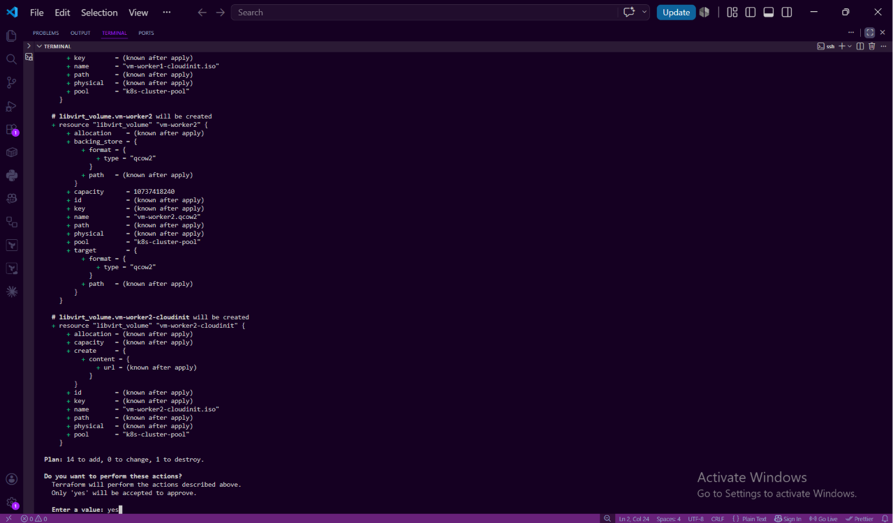

jika ada output seperti itu langsung saja ketik **yes** agar terraform seger mengeksekusi tugasnya

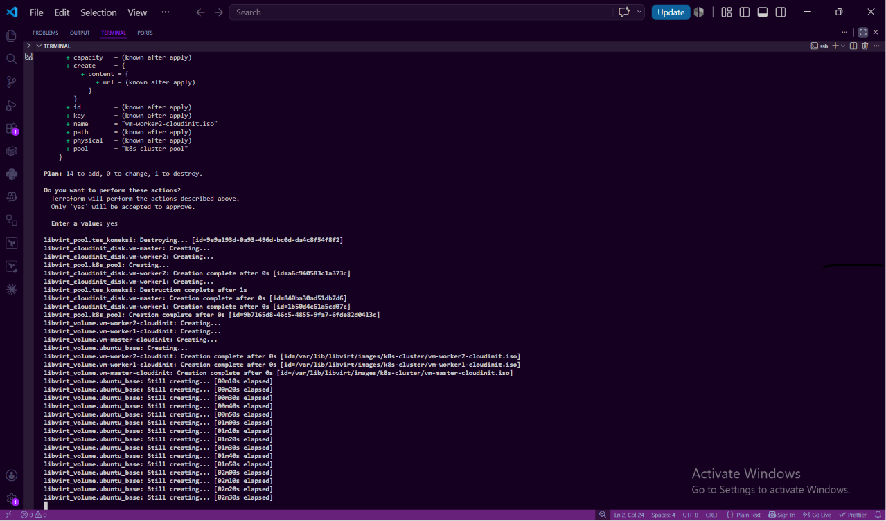

tunggu hingga selesai jika sudah maka akan ada output seperti ini

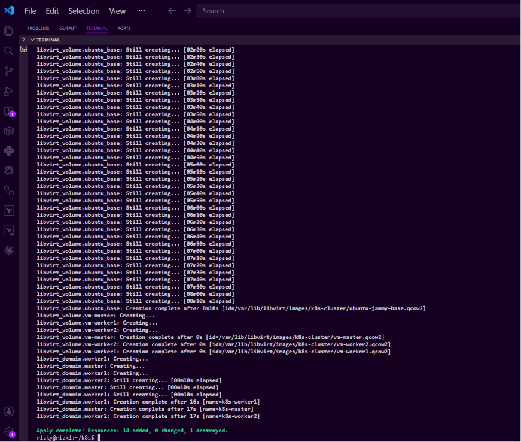

jika ada output seperti diatas maka selamat terraform sudah berhasil mengeksekusi semua tasknya dah domain atau node sudah ada,masuk ke wsl untuk verifikasi apakah ada node atau domain 
yang sudah dibuat gunakan command

```
virsh list --all
```

untuk mengecek apakah ada node atau domain yang sedang berjalan

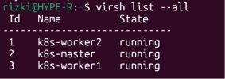

jika ada output dari commandnya itu berarti semua sudah berjalan dengan baik sekarang cek apakah node sudah berhasil mendapatkan ip gunakan command

```
virsh net-dhcp-leases default
```

jika sudah maka akan ada output seperti ini

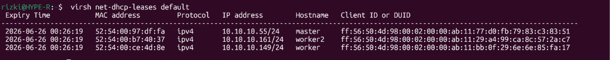

### Setup Kubernetes

sebelum masuk ke playbook ubah inventory terlebih dahulu menjadi seperti ini

```
rizky@rizki:~/k8s$ cat inventory 
[Jenkins]
rizky ansible_host=ip-laptop2 ansible_user=rizky ansible_password=$your-password

[masters]
k8s-master ansible_host=ip-node-master ansible_user=ubuntu ansible_password=$your-password

[workers]
k8s-worker1 ansible_host=ip-node-worker1 ansible_user=ubuntu ansible_password=$your-password
k8s-worker2 ansible_host=ip-node-worker2 ansible_user=ubuntu ansible_password=$your-password


[all:vars]
ansible_ssh_common_args='-o ProxyJump=rizki@ip-laptop1 -o StrictHostKeyChecking=no'
```

nantinya laptop 2 akan melakukan ssh jump ke laptop 1 lalu laptop 1 akan meneruskan ssh dari laptop 2 ke domain atau node-node yang sudah di buat
masuk ke folder k8s lagi lalu buat playbook untuk installasi k8s,playbook pertama 

```
vim playbook-swap-native.yaml
|
- name: disable swap permanent
  hosts: masters,workers
  become: yes
  tasks:
    - name: comment out entri swap di fstab
      ansible.builtin.replace:
        path: /etc/fstab
        regexp: '^([^#\n].*\sswap\s.*)$'
        replace: '# \1'
        backup: yes
    - name: disable swap sekarang
      ansible.builtin.command: swapoff -a
      when: ansible_swaptotal_mb > 0

```

playbook diatas merupakan playbook untuk membuat swap mati secara permanent,dengan mencari regex dari path file tertentu misal dengan
menggunakan regexp kita bisa mencari pola baris tertentu dengan membuat baris 

```
regexp: '^([^#\n].*\sswap\s.*)$'
```

lalu nantinya akan direplace atau gantikan dengan

```
replace: '# \1'
```

modul ansible.builtin.replace mencari baris swap di /etc/fstab dengan regex, lalu menambahkan # di depannya supaya swap tidak aktif lagi setelah reboot,
trus untuk task selanjutnya itu gunakan swapoff -a sebagai task yang akan memastikan swap benar benar mati meskipun node di reboot,gunakan modul ansible.builtin.command agar bisa
menggunakan perintah swapoff -a dan gunakan when agar memiliki nilai idempotent jika sudah maka gunakan command

```
ansible-playbook playbook.yaml
|
ansible-playbook playbook-swap-native.yaml
```

selanjutnya yaitu untuk menambahkan port yang nantinya akan digunakan oleh kubernetes

```
vim playbook-allow-port-native.yaml
|
- name: activate ufw
  hosts: masters,workers
  become: yes

  tasks:
    - name: allow port for ssh
      community.general.ufw:
        port: 22
        rule: allow
        proto: tcp
    - name: allow port for CNI plugin (use case flannel)
      community.general.ufw:
        port: 8472
        rule: allow
        proto: udp

- name: allow port
  hosts: workers
  become: yes

  tasks:
    - name: allow port
      community.general.ufw:
        port: 30000:32767
        rule: allow
        proto: tcp
    - name: allow port 2
      community.general.ufw:
        port: 10250
        rule: allow
        proto: tcp

- name: allow port2
  hosts: masters
  become: yes

  tasks:
    - name: allow port2
      community.general.ufw:
        port: 10257:10259
        rule: allow
        proto: tcp
    - name: allow-port2
      community.general.ufw:
        port: 6443
        rule: allow
        proto: tcp
    - name: allowport2
      community.general.ufw:
        port: 2379:2380
        rule: allow
        proto: tcp
- name: daemon-reload
  hosts: masters,workers
  become: yes

  tasks:
    - name: daemon-reload
      ansible.builtin.systemd_service:
        daemon_reload: true

- name: enable ufw
  hosts: masters,workers
  become: true

  tasks:
    - name: set default forward policy ke allow
      community.general.ufw:
        default: allow
        direction: routed

    - name: Ensure UFW is activated and enabled
      community.general.ufw:
        state: enabled

```

pada playbook kali ini saya membuat sebuah perbaikan dan untuk postingan iac yang [ini](https://rizkiyusupk.github.io/devops/kubernetes/linux/server/iac/infrastructure/iac2/),pada 
postingan ini sebelumnya saya malah melakukan kesalah kedua yaitu menggunakan modul **ansible.builtin.firewalld** yang dimaan itu merupakan bawaan rhel dan malah saya gunakan
jadinya saya perbaiki lagi sekarang sudah diperbaiki,untuk detail errornya nanti saya tulis di error post,di playbook allow port yang baru terdapat 5 play,untuk play pertama berisi task untuk mengizinkan ssh agar allow dan diizinkan oleh ufw sebagai firewall task selanjutnya yaitu untuk allow cni port agar nantinya node k8s bisa saling komunikasi dan di case ini saya menggunakan flannel jadinya saya allow port flannel,lalu masuk ke play selanjutnya yaitu port yang dibutuhkan oleh workers agar nantinya service bisa di akses jika menggunaak nodeport service dan task selanjutnya untuk kubelet,masuk ke play 3 untuk play ini khusus master jadinya semua port yang akan dibutuhkan master node akan ada disini,seperti 6443 untuk api,dll,masuk ke play selanjutny yaitu play reload daemon agar nantinya systemd bisa mereload semua config yang sudah di terapkan tadi,masuk ke play terakhir yaitu ufw enable agar semua rule tadi bisa berfungsi karena ufw aktifjika sudah maka masuk ke penjelasannya nah dalam playbook ini terdapat jika sudah gunakan command

```
ansible-playbook playbook.yaml
|
ansible-playbook playbook-allow-port-native.yaml
```

masuk ke playbook untuk menambahkan dns hosts name,nah untuk lebih mempermudah node agar saling mengenal satu sama lain saya akan membuat sebuah playbook yang berfungsi untuk menambahkan 
dns hosts langsung saja masuk ke playbooknya

```
vim playbook-ip-native.yaml
|
- name: adding diffrent ip for node
  hosts: masters,workers
  become: yes

  tasks:
    - name: add ip
      ansible.builtin.blockinfile:
        path: /etc/hosts
        block: |
           ip-node1 master
           ip-node2 worker1
           ip-node3 worker2
        create: yes

```

saya menggunakan module block in file agar saya bisa menulis banyak baris di /etc/hosts nya dari pada saya harus menulis satu per satu baris,meskipun 
menggunakan block in file itu terdapat baris seperti ini

```
# BEGIN ANSIBLE MANAGED BLOCK
192.168.2.35 node1
192.168.2.36 node2
192.168.2.37 node3
# END ANSIBLE MANAGED BLOCK
```

tapi bukan masalah besar karena baris itu sudah menjadi sebuah comment dan tidak akan berpengaruh apapun,yah meskipun kurang menarik secara penampilan
nammun ya balik lagi inikan terminal bukan gui :v jika sudah gunakan command

```
ansible-playbook playbook.yaml
|
ansible-playbook playbook-ip-native.yaml
```

oke playbook selanjutnya bagian config beberapa modul tambahan seperti set sysctl dan 
modprobe,langsung saja masuk ke playbooknya

```
vim playbook-config-native.yaml
|
- name: do a configuration
  hosts: masters,workers
  become: yes

  tasks:
    - name: set a module for modprobe
      community.general.modprobe:
        name: "{{ item }}"
        state: present
        persistent: present
      loop:
        - overlay
        - br_netfilter
    - name: set sysctl untuk kubernetes
      ansible.posix.sysctl:
        name: "{{ item }}"
        value: '1'
        sysctl_file: /etc/sysctl.d/k8s.conf
        sysctl_set: true
        reload: true
      loop:
        - net.bridge.bridge-nf-call-iptables
        - net.ipv4.ip_forward
        - net.bridge.bridge-nf-call-ip6tables
```

diplaybook ini hanya ada satu play dan task pertama yaitu load module agar k8s dan containerd bisa berjalan dengan aman dan tanpa adanya error atau kesalahan ketika nantinya proses installasi k8s dan containerd selesai,lalu nantinya module di load secara permanen agar ketika node reboot module tidak hilang,masuk ke task selanjutnya yaitu ssyctl untuk masalah network yang nantinya bisa diteruskan ke iptables dan berlaku untuk ipv4 dan ipv6,dan load module modprobe harus di run terlebih dahulu agar task sysctl bisa berjalan,jika sudah gunakan command

```
ansible-playbook playbook-name.yaml
|
ansible-playbook playbook-config-native.yaml
```

ekarang masuk ke bagian playbook untuk installasi cri atau container runtime interface,disini saya memakai containerd sebagai cri 

```
vim playbook-pkg-native.yaml
|
- name: install cri
  hosts: masters,workers
  become: yes
  tasks:
    - name: Install prerequisite packages
      ansible.builtin.apt:
        name:
          - apt-transport-https
          - ca-certificates
          - curl
          - gnupg
          - lsb-release
        state: present
        update_cache: yes

    - name: Ensure keyrings directory exists
      ansible.builtin.file:
        path: /etc/apt/keyrings
        state: directory
        mode: "0755"

    - name: Download Docker GPG key
      ansible.builtin.get_url:
        url: https://download.docker.com/linux/ubuntu/gpg
        dest: /etc/apt/keyrings/docker.asc
        mode: "0644"

    - name: Add Docker repository
      ansible.builtin.apt_repository:
        repo: "deb [arch=amd64 signed-by=/etc/apt/keyrings/docker.asc] https://download.docker.com/linux/ubuntu  {{ ansible_distribution_release }}  stable"
        filename: docker
        state: present
        update_cache: yes
    - name: install containerd
      ansible.builtin.apt:
        name: containerd.io
        state: present
    - name: Create a directory if it does not exist
      ansible.builtin.file:
        path: /etc/containerd
        state: directory
        mode: "0755"
        owner: root
        group: root
    - name: take default config containerd
      ansible.builtin.command: containerd config default
      register: containerd_default
      changed_when: false

    - name: write config containerd (SystemdCgroup=true)
      ansible.builtin.copy:
        content: "{{ containerd_default.stdout | regex_replace('SystemdCgroup = false', 'SystemdCgroup = true') }}\n"
        dest: /etc/containerd/config.toml
        owner: root
        group: root
        mode: "0644"
      notify: Restart containerd
    - name: Enable service
      ansible.builtin.systemd_service:
        name: containerd
        enabled: true
        masked: no
  handlers:
    - name: Restart containerd
      ansible.builtin.systemd_service:
        name: containerd
        state: restarted

```

untuk bagian playbook install containerd hanya ada satu play tapi terdiri dari beberapa task,task pertama installasi semua requirment yang akan dibutuhkan untuk installasi containerd,lalu masuk ke task selanjutnya 
yaitu membuat directory dimana nantinya key yang diambil dari repo docker disimpan,tentunya key ini menjadi salah satu bagian penting ,lalu task selanjutnya yaitu mendowload key dari url yang resmi yaitu dari docker,
task selanjutnya yaitu untuk mendaftarkan repo dan mengarahkan apt memverifikasi paket dengan key tersebut,task selanjutnya yaitu installasi dari containerd dengan menggunakan modul apt karena dua 
task sebelumnya adalah kunci dari installasi jadi task ini hanya menginstall continerd saja oh ya dan saya disini menggunakan container.io,oke masuk ke task selanjutnya yaitu membuat directory untuk config toml 
containerd,supaya nantinya containerd bertindak sebagai cri sepenuhnya dan k8s membutuhkan containerd sebagai cri nah jika config dibiarkan default maka containerd tidak bertindak sebagi cri dan plugin tidak aktif,maka dari itu sesuai docs config default harus di re-write agar fungsinya sebagai cri akan berjalan

```
config default -> tidak memiliki atau tidak mengaktifkan fungsi cri / pluggin cri
re-write config -> bisa mengaktifkan fungsi atau plugin cri
```

kurang lebih begitu,oke masuk ke task selanjutnya yaitu re-write config atau membuat config baru lalu simpan stdout nya ke sebuah variable,masuk ke task selanjutnya di task ini stdout di edit dengan mengambil
stdout dari variable tadi lalu ubah dengan mencari regex

```
 regex_replace('SystemdCgroup = false', 'SystemdCgroup = true') }}\n
```

di baris ini systemdcgroup di ubah dari false ke true,ini penting karena mengikuti k8s config di k8s nanti kubelet berjalan dengan systemdcgroup=true,makanya ini dibutuhkan agar k8s berjalan dengan baik,dan ada notify yang nantinya bisa mentrigger handler untuk melakukan restart containerd untuk menload config baru tapi ingat bahwa notify hanya akan berjalan jika saja task "changed" itu berarti jika task tidak change notify tidak akan mentrigger handler dan juga handler berjalan diakhir,dan task terakhir yaitu enable containerd 
gunakan command

```
ansible-playbook playbook-name.yaml
|
ansible-playbook playbook-pkg-native.yaml
```

untuk selanjutnya yaitu installasi kubernetes langsung saja

```
vim playbook-kubernetes-native.yaml
|
- name: install kubernetes package
  hosts: masters,workers
  become: yes

  tasks:
    - name: Ensure keyrings directory exists
      ansible.builtin.file:
        path: /etc/apt/keyrings
        state: directory
        mode: "0755"
    - name: install gpg key for kubernetes
      ansible.builtin.get_url:
        url: https://pkgs.k8s.io/core:/stable:/v1.28/deb/Release.key
        dest: /etc/apt/keyrings/kubernetes-apt-keyring.asc
        mode: "0644"
    - name: adding file
      ansible.builtin.apt_repository:
        repo: "deb [signed-by=/etc/apt/keyrings/kubernetes-apt-keyring.asc] https://pkgs.k8s.io/core:/stable:/v1.28/deb/ "
        filename: kubernetes
        state: present
        update_cache: yes
    - name: install 3 main component
      ansible.builtin.apt:
        name: "{{ item }}"
        state: present
      loop:
        - kubelet
        - kubeadm
        - kubectl
    - name: enable kubelet
      ansible.builtin.systemd:
        state: started
        enabled: yes
        name: kubelet
```

oke masuk ke playbook installasi k8s,diplaybook ini hanya ada satu play ditask pertama seperti biasa membuat directory untuk menyimpan key ya meskipun di playbook tadi sudah tapi kan beda host heheh:),oke
lanjut ke task selanjutnya untuk mendownload key dari url resmi k8s lalu menyimpannya ke directory yang sudah dibuat tadi,masuk ke task salnjjutnya yaitu agar apt memverifikasi paket menggunakan key yang sudah 
disimpan tadi dan task selanjutnya tinggal melakukan installasi paket saja karena key dan paket sudah terverifikasi kubelet,kubeadm,kubectl,dan task terakhir enable kubelet,gunakan coomand

```
ansible-playbook playbook-name.yaml
|
ansible-playbook playbook-kubernetes-native.yaml
```

jika sudah masuk ke playbook terakhir yaitu untuk join kubernetes

```
vim playbook-join-native.yaml
|
- name: join to cluster
  hosts: masters
  become: yes

  tasks:
    - name: pre pull image k8s
      ansible.builtin.command: kubeadm config images pull
      changed_when: false
    - name: init
      ansible.builtin.command: kubeadm init --apiserver-advertise-address=ip-node-master --pod-network-cidr=10.244.0.0/16 --node-name=$node1 --apiserver-cert-extra-sans=127.0.0.1,ip-laptop1
      args:
        creates: /etc/kubernetes/admin.conf
    - name: Buat join command
      ansible.builtin.command: kubeadm token create --print-join-command
      register: join_command_output
      changed_when: false
    - name: join command
      set_fact:
        join_command: "{{ join_command_output.stdout }}"

- name: workers join to cluster
  hosts: workers
  become: yes
  tasks:
    - name: join cluster
      ansible.builtin.shell: "{{ hostvars[groups['masters'][0]]['join_command'] }}"
      args:
        creates: /etc/kubernetes/kubelet.conf

```

jika sudah gunakan command

```
ansible-playbook playbook.yaml
|
ansible-playbook playbook-join-native.yaml
```

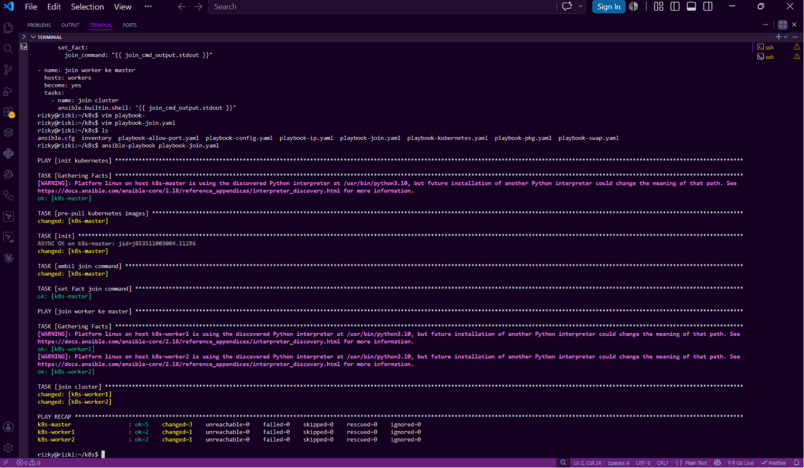

task pertama yaitu untuk menarik config image agar proses init tidak terlalu lama atau memakan banyak sekali waktu hingga bisa  time out dan proses init bisa eror,selanjutnya 
saya mengunakan builtin command untuk melakukan init di kubernetes karena saya sebelumnya sudah melakukan penarikan image agar proses init tidak memakan waktu terlalu lama,jadinya untuk
proses init bakalan lebih singkat,di task berikutnya saya melakukan generate token dengan menggunakan modul command trus saya simoan di variable bernama join_command_output,setelah itu di 
task berikutnya saya gunakan set fact,agar nantinya bisa di gunakan di task lainnya,masuk ke play kedua dimana semua node akan join ke kubernetes,di sini saya menggunakan modul
command untuk melakukan join,sama seperti di projek sebelumnya play kedua itu adalah join commandnya untuk di play ini khusus worker
saja, si worker akan bertanya ke master "apakah ada variable yang bernama join_command_output? jika ada aku mau menggunakannya!!" kurang lebih seperti itu dari task di play 2
jika sudah gunakan command untuk membuat sebuah directory khusus kubernetes di home gunakan command

```
mkdir -p $HOME/.kube
sudo cp -i /etc/kubernetes/admin.conf $HOME/.kube/config
sudo chown $(id -u):$(id -g) $HOME/.kube/config
```

jika sudah install cni untuk network saya menggunakan flannel

```
kubectl apply -f https://github.com/flannel-io/flannel/releases/latest/download/kube-flannel.yml
```

cek apakah node sudah berhasil join gunakan coomand

```
kubectl get nodes
```

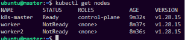

### SETUP NGROK
Dikarenakan gitlab yang saya pakai itu adalah gitlab web jadinya gitlab perlu mengakses ke ip vm saya sedangkan vm saya adalah local jadinya saya perlu sesuatu agar gitlab bisa mengakses 
vm saya maka saya akan menggunakan ngrok disini [install ngrok](https://ngrok.com/download/linux),jika sudah terinstall ambil token auth ngrok dengan masuk ke websitenya,jika sudah masuk 
dan login masuk ke your auth token 

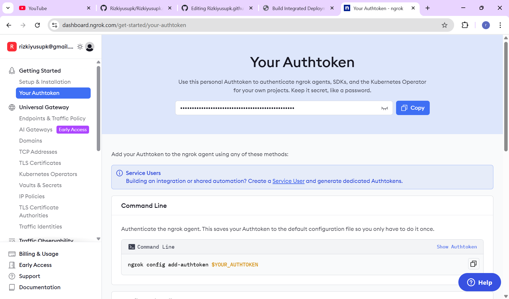

kurang lebih seperti ini tampilannya,copy lalu pergi ke terminal jenkins llau ketik command ini

```
ngrok config add-authtoken <token>
```

ganti token dengan auth token yang tadi di copy lalu jalankan ngrok dengan command

```
ngrok http 9091
```

arahkan ke port dimana jenkins berjalan agar nantinya bisa melakukan webhook,jika sudah maka akan ada output seperti ini

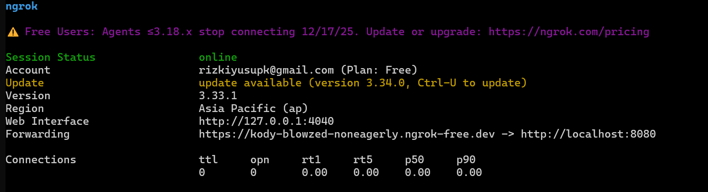

simpan link yang diberikan nantinya akan di pakai untuk webhook

### SETUP GITLAB
Pada tahap ini saya akan mensetup atau configurasi gitlab untuk nantinya bisa terhubung dengan node,
pertama-tama buat keybaru untuk user jenkins lalu simpan di direktori user yang sebelumnya sudah di buat 

```
sudo -u jenkins ssh-keygen -t rsa -b 4096 -C "jenkins@your-vm" -f /var/lib/jenkins/.ssh/id_rsa -N ""
```

ganti **@your-vm** jadi ip dari vm dan arahkan ke direktori folder user jenkins

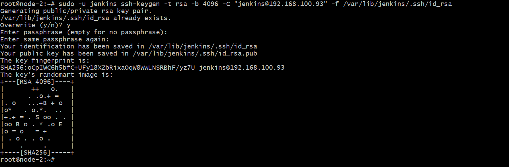

jika sudah buat file ssh-key yang baru saja dibuat 

```
sudo cat /var/lib/jenkins/.ssh/id_rsa.pub
```

jika tidak bisa menggunakan command diatas masuk terlebih dahulu sebagai root lalu buka filenya

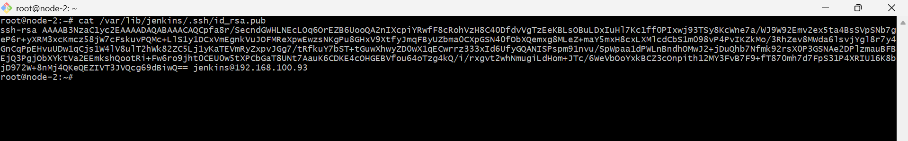

kurang lebih seperti ini nah jika sudah lalu copy semua outputnya lalu pergi ke browser lalu ketik gitlab,pastikan punya akun gitlabnya setelah 
itu login lalu pergi ke edit profile setelah itu 
masuk ke menu ssh-key di sebelah kiri

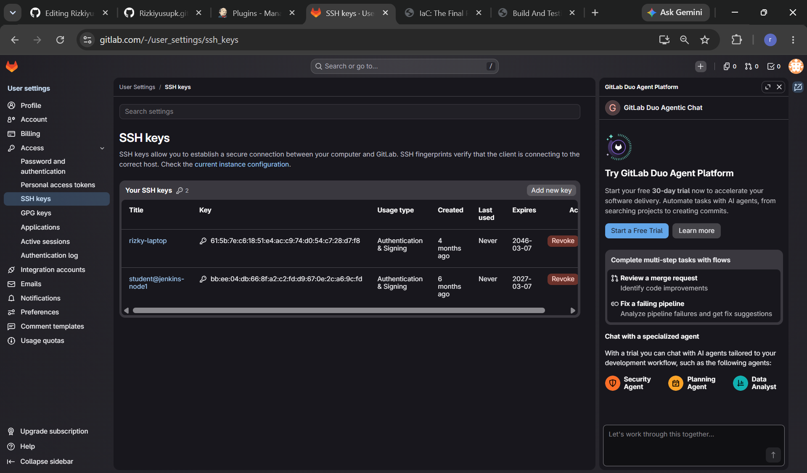


kurang lebih seperti diatas menu di bagian ssh-key,nah setelah itu klik add new key,paste yang sudah di copy tadi lalu 
tambahkan title misal auth lalu set ke authentication & signing setelah itu set expiration datenya bebas terserah kamu

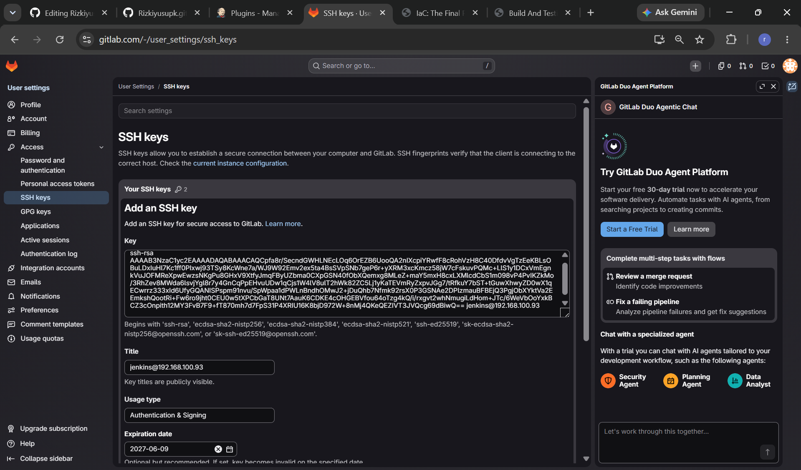

jika sudah klik tombol add

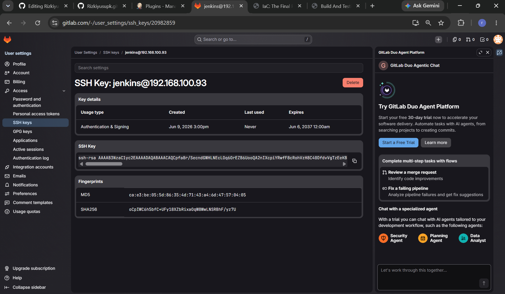


setelah itu test apakah jenkins sudah terhubung dengan gitlab dengan command 

```
sudo -u jenkins ssh -T git@gitlab.com
```

kurang lebih outputnya seperti ini

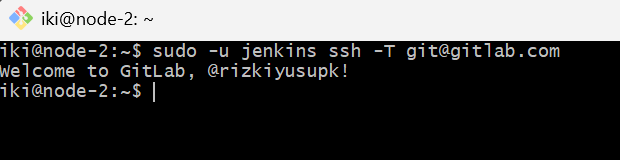

jika output sama seperti diatas selamat karena gitlab sudah berhasil terhubung dengan jenkins

### Copy KubeConfig To Jenkins

Masuk ke bagian yang agak tricky yaitu proses copy kubeconfig agar nantinya jenkins atau laptop 2 bisa mengakses cluster kubernetes yang berada di dalam wsl2 di laptop ,oke tanpa berlama-
lama lansung saja pertama-tama tambahkan tunneling  difile config

```
vim .ssh/config
|
Host hype-r
    HostName ip-laptop1
    User rizki
    IdentityFile ~/.ssh/id_rsa
    LocalForward 6443 ip-master-node:6443
```

untuk penambahan dari file config cukup tambahkan sepertidiatas saja ada bagian local forward  untuk bagian laptop 1 atau hype-r,kenapa harus menambahkan tunneling seperti ini? karena
nantinya tunneling berfungsi sebagai terowongan akses agar jenkins atau laptop2 bisa mengakses cluster menggunakan comamnd kubectl get nodes,jika sudah masuk ke bagian selanjutnya yaitu
copy paste kubeconfig yang ada di master node tinggal ssh saja 

```
ssh k8s-master
```

karena sudah set nama node master di config dengan nama **k8s-master** tinggal ssh dengan nama itu,trus buka file kubeconfig

```
cat .kub/config
```

copy semua output dari file itu lalu pindahke terminal laptop 2 buat sebuah folder dan file yang nantinya akan jadi tempat dari kubeconfig 

```
sudo mkdir -p /var/lib/jenkins/.kube
sudo chown -R jenkins:jenkins /var/lib/jenkins/.kube 
```

oke folder sudah bagian membuat file config

```
sudo vim /var/lib/jenkins/.kube/config
```

pastekan semua output yang sudah di copy tadi kedalam file config jika sudah keluar,jika sudah tinggal set bagian ip server dari config yang ada di dalam laptop 2

```
sudo -u jenkins kubectl config set-cluster kubernetes --server=https://127.0.0.1:6443
```

lalu jika sudah coba lakukan testting tunneling dari laptop 2 ke node master yang ada di laptop 1 

```
ssh -L 6443:ip-node-master:6443 rizki@ip-laptop1 -N &
```

lalu jika sudah coba testing untuk akses dari si laptop 2

```
sudo -u jenkins kubectl get nodes
```

maka akan ada output seperti ini 

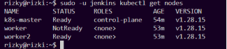

### Test

memasuki tahap akhir yaitu tahap testing apakah sistem yang dibangun benar-benar berfungsi sebagaimana semestinya,langsung saja masuk ke dalam tahapnya pertama-tama
buka gitlab web lali login dengan akun yang dimiliki,setelah itu buat projek didalam halaman gitlab

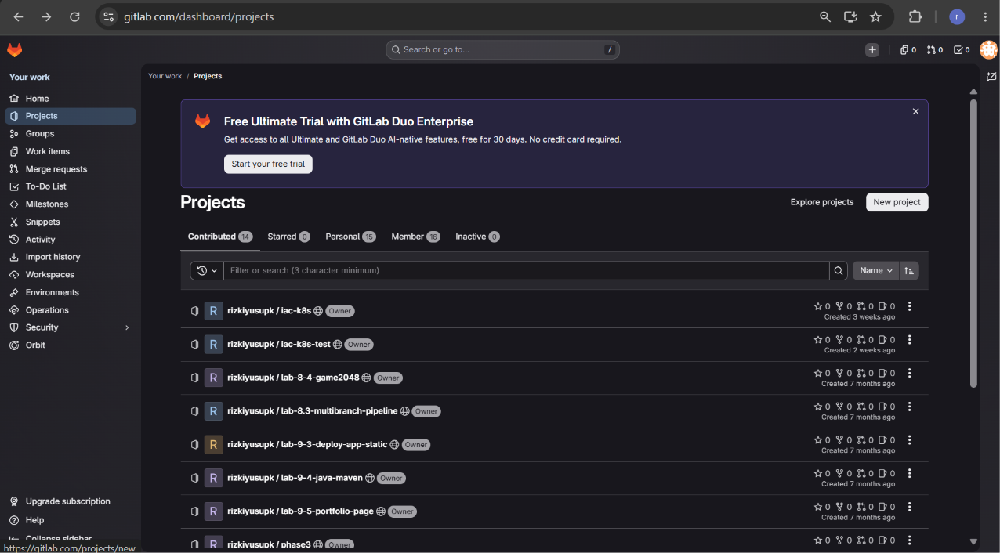

klik new projek yang berada di pojok kanan atas didalam gambar setelah itu

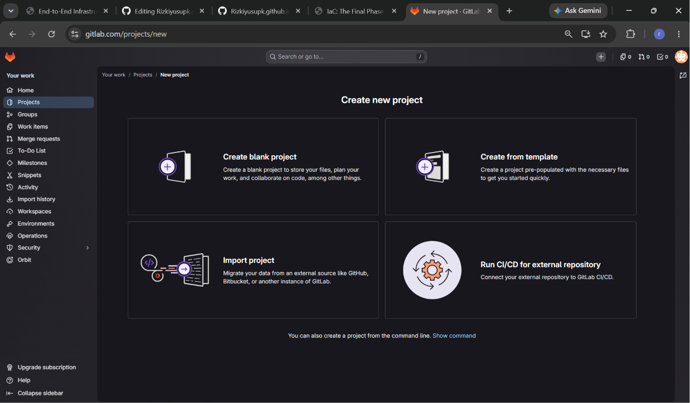

klik black project nanitnya akan diarahkan ke halaman seperti ini

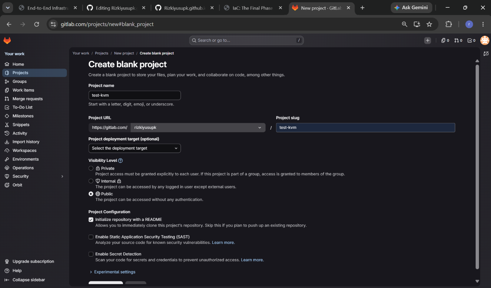

isi semua kolom mulai dari nama repository lalu url dari repository  dan set repository projek ke dalam public jika sudah create project
lalu buka vscode dan buke terminal baru, copy url dari repository projek tadi lalu clone gunakan command

```
git clone https://url-repo
```

jika sudah melakukan clonening bisa masuk kedalam directory dari repo yang baru saja di clone lalu buat sebuah Jenkinsfile

```
vim Jenkinsfile
|
pipeline {
    agent any
    stages {
        stage('Test Webhook') {
            steps {
                echo 'Webhook triggered successfully!'
                sh 'ls -la'
            }
        }
    }
}
```

isi Jenkinsfile hanya sementara untuk melakukan testing terlebih dahulu,oke jika sudah keluar dari terminal lalu pindah ke terminal laptop 2 untuk mengaktifkan tunneling dengan ngrok
gunakan command

```
ngrok http 9091
```

dan biarkan terminal tetap terbuka agar tunneling tetap berjalan

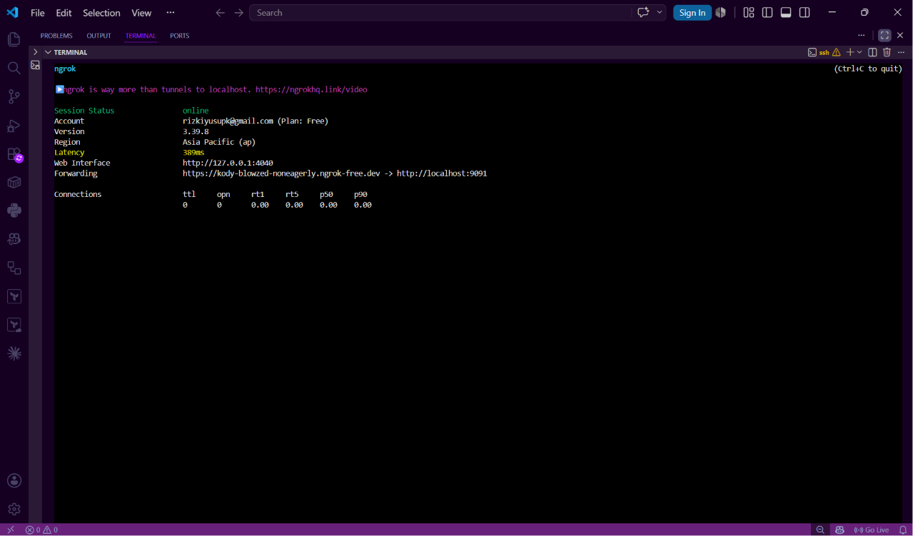

jika sudha buka ke browser masuk ke jenkins dashboard

```
ip-node:9091
```

ketik ip dari node jenkins atau laptop 2 lalu port dimana jenkins berjalan biasaanya default port untuk jenkins ialah 8080
akan ada tampilan dashboard seperti ini 

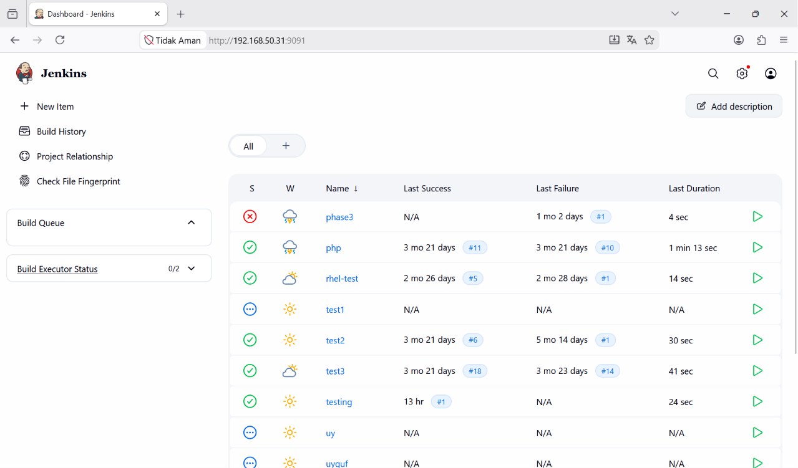

oke langsung saja buat new item 

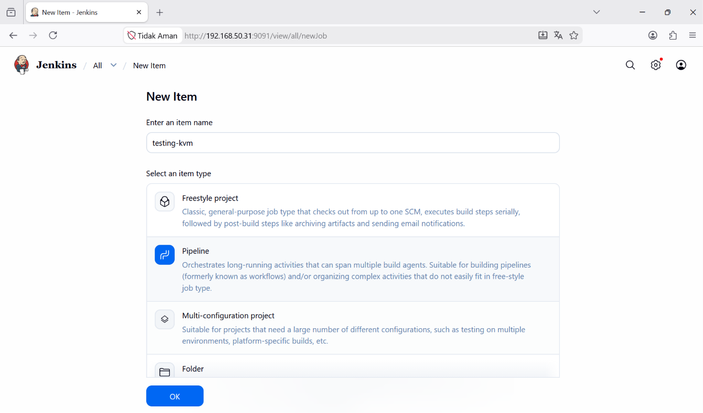

langsung saja buat item dengan tipe pipeline lalu klik ok untuk membuat itemnya atau pipelinenya

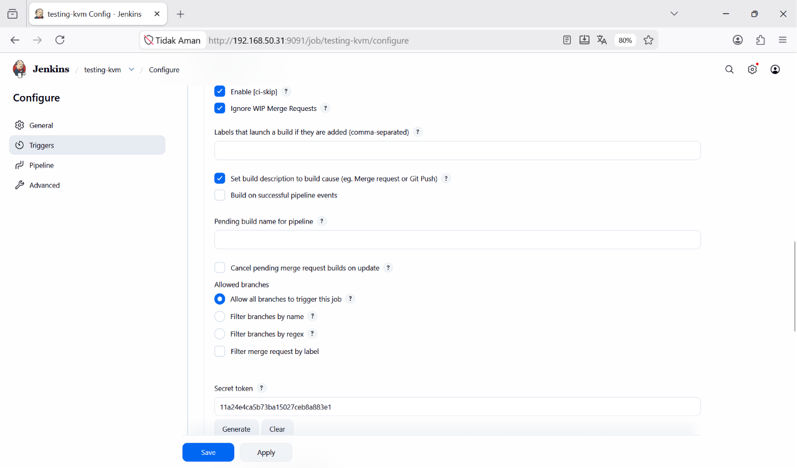

scroll saja langsung kebawah kebagian **build when change** lalu isi kotak atau checklist bagian itu setelah itu


jika sudah scroll ke bawah lalu klik generate secret token copy token itu lalu pindah ke gitlab lagi kebagian settings
dan pilih menu webhook dibagian menu webhook 

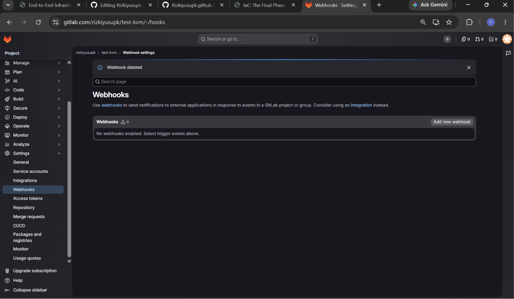

pilih add new webhhook lalu isi kolom seperti url,name dan secret token yang paling penting
dan untuk url ganti dengan url yang diberikan ngrok lalu pastekan url tersebut ditambah home folder dari projek yang tersimpan misal 

```
url-ngrok/project/nama-pipeline
```

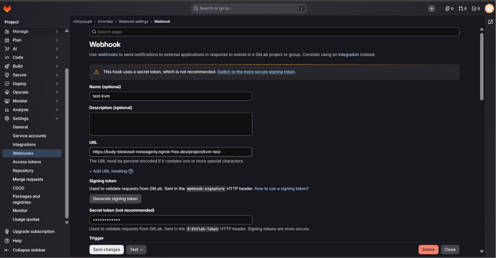

jika sudah isi semua bagian di bawah checklist semua bagian lalu unchecklist bagian enable ssl.Jika sudah klik add webhook 
pindah lagi ke dashboard jenkins scroll kebagian bawah kebgaian pipeline lalu ganti definition pipelinenya menjadi **pipeline script from SCM**

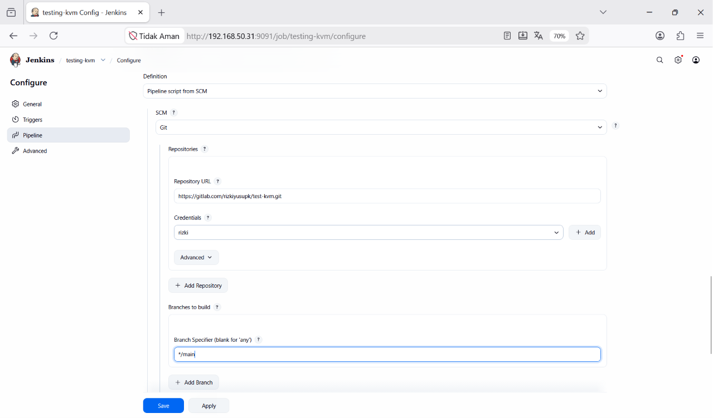

lalu isi kolom repository menggunakan url repo dan bagian credentials isi dengan credentials yang sebelumnya sudah dibuat lalu ganti branch sesuai dengan yang ada di repository
disini saya ganti ke main lalu save,pindah ke terminal laptop 1 yang sebelumnya dipakai untuk clone repository langsung saja test trigger dengan push ke main branch

```
git add .
git commit -m "add file"
git push origin main
```

tunggu hingga proses selesai lalu check ke dashboard jenkins lagi untuk memeriksa apakah pipeline berjalan 

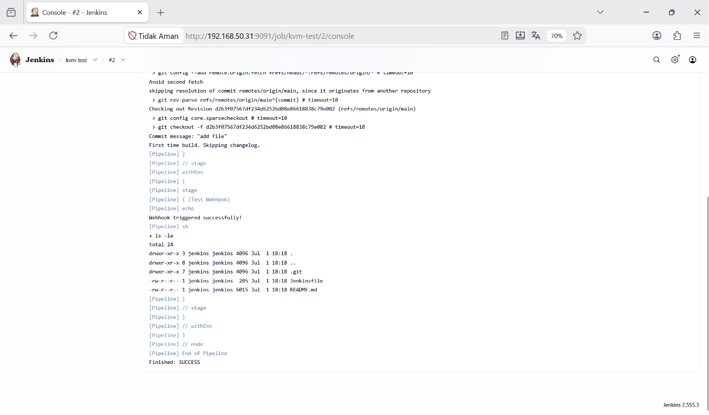

oke jika sudah berjalan maka sistem sudah berjalan dengan normal

### Deploy

Oke karena testing sudah berjalan dan ternyata sistemnya jalan dengan normal sekarang bagian deployment time langsung saja buka terminal laptop 1 yang ada directory reponya lalu buat
sebuah file manifest kube

```
vim kube.yaml
|
apiVersion: apps/v1
kind: Deployment
metadata:
  name: apps1
  labels:
    apps1: test
spec:
  replicas: 1
  selector:
    matchLabels:
      apps1: test
  template:
    metadata:
      labels:
        apps1: test
    spec:
      containers:
        - name: nginx
          image: nginx
          ports:
            - containerPort: 80


---
apiVersion: v1
kind: Service
metadata:
  name: apps1-service
spec:
  selector:
    apps1: test
  ports:
    - port: 80
      targetPort: 80
      nodePort: 30000
      protocol: TCP
  type: NodePort
```

oke karena sudah dengan pembuatan file kube tinggal update bagian Jenkinfile

```
vim Jenkinsfile
|
pipeline {
    agent any
    stages {
        stage('Test Webhook') {
            steps {
                echo 'Webhook triggered successfully!'
                sh 'ls -la'
                sh 'kubectl apply -f kube.yaml' <--- tambah ini
            }
        }
    }
}
```

oke jika sudah keluar dari vim lalu seperti biasa push ke repository

```
git add .
git commit -m "add file"
git push origin main
```

tunggu hingga proses push selesai lalu check kembali ke jenkins dashboard 

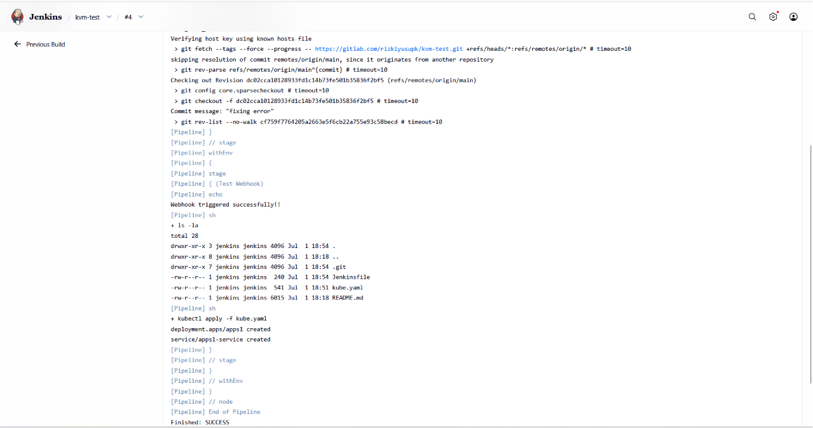

output seperti diatas deployment berhasil dilakukan sekarang check 
di node master

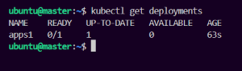
